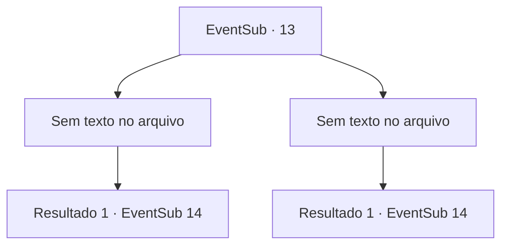

# Eventos secundários · 13

[Índice da tabela](index.md) · [Índice geral](../index.md)

ID: `pt:EventSub:13` · Fonte: `EventSub4` · Versão: 1.2.47.

Mapeamento estático dos arquivos; a disponibilidade e a execução dependem do estado da run.

## Texto do evento

*Sem texto no arquivo.*

## Dados de entrada

```json
{
  "id": 13,
  "grade": 1,
  "subEvent": "0",
  "required": ""
}
```

## Mapa das escolhas



## Escolhas e resultados

### Escolha 1

*Sem texto no arquivo; o papel dessa opção depende da interface do jogo.*

Requisitos e outros campos da escolha:

```json
{
  "required": ""
}
```

#### Resultado 1.1

A aranha gigante treme e desmorona. Majet fala enquanto recupera uma flecha do seu cadáver. 

 "Isso foi bastante impressionante. Devemos continuar?"

  Depois de caminhar um pouco mais, você encontra uma grande caverna. |drawing_spiderCave|Você ouve alguém cantando lá dentro. 

 "Parece ser um homem... cantando em uma caverna? Nada suspeito."

 Majet tira o arco de seu ombro quando entra. Você a segue pelas profundezas da caverna. Dentro, há um homem cantando confortavelmente em sua cama. Ele pula quando os vê entrando. 

 "Quem... quem diabos é você?"


Continuação registrada: [Evento 14](0014.md) na mesma tabela.

```json
{
  "required": "",
  "chance": "1",
  "nextEvent": 14,
  "type": 2,
  "reward": "0_2_1"
}
```

### Escolha 2

*Sem texto no arquivo; o papel dessa opção depende da interface do jogo.*

Requisitos e outros campos da escolha:

```json
{
  "required": ""
}
```

#### Resultado 2.1

A presa venenosa da aranha fica a centímetros de sua carne quando leva uma flecha na cabeça. Treme e entra em colapso. Majet fala, enquanto recupera uma flecha de seu cadáver. 

 "Ufa ... isso foi por pouco. Vem."

 Ela estende a mão e o ajuda. 

 Depois de um pouco mais de caminhada, você encontra uma caverna grande.|drawing_spiderCave|Você ouve alguém cantando de dentro dela. 

 "Parece um homem ... cantando em uma caverna? Nada suspeito."

 Majet tira o arco de seu ombro quando ela entra. Você a segue pelas profundezas da caverna. No interior, um homem cantando do conforto de sua cama. Ele pula enquanto vê vocês dois entrando. 

 "Quem ... quem diabos é você?"


Continuação registrada: [Evento 14](0014.md) na mesma tabela.

```json
{
  "required": "",
  "chance": "1",
  "nextEvent": 14,
  "type": 2,
  "reward": ""
}
```

## Referências que chegam a este evento

- [Evento 12 · escolha 1 · resultado 1](0012.md#escolha-1)
- [Evento 12 · escolha 2 · resultado 1](0012.md#escolha-2)
