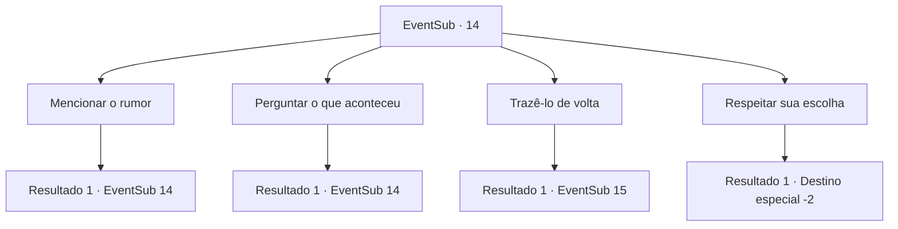

# Eventos secundários · 14

[Índice da tabela](index.md) · [Índice geral](../index.md)

ID: `pt:EventSub:14` · Fonte: `EventSub4` · Versão: 1.2.47.

Mapeamento estático dos arquivos; a disponibilidade e a execução dependem do estado da run.

## Texto do evento

*Sem texto no arquivo.*

## Dados de entrada

```json
{
  "id": 14,
  "grade": 1,
  "subEvent": "0",
  "required": ""
}
```

## Mapa das escolhas



## Escolhas e resultados

### Escolha 1

Mencionar o rumor

Requisitos e outros campos da escolha:

```json
{
  "required": "5_3_0"
}
```

#### Resultado 1.1

Você diz a ele o que ouviu de Anna e que ela está preocupada. 

 "Hahaha... Então ela está preocupada com aranhas que mudam de forma? Provavelmente é um truque de luz. Ou talvez Anna esteja apenas com ciúmes. De qualquer forma, não tenho intenção de voltar. Por favor, diga para não me procurar mais. Na verdade, diga a ela que estou morto. Então ela desistirá."

 Johnny disse enquanto balançava a cabeça.

Continuação registrada: [Evento 14](0014.md) na mesma tabela.

```json
{
  "required": "",
  "chance": "1",
  "nextEvent": 14,
  "type": 2,
  "reward": "5_3_1"
}
```

### Escolha 2

Perguntar o que aconteceu

Requisitos e outros campos da escolha:

```json
{
  "required": "5_4_0"
}
```

#### Resultado 2.1

Você pergunta como ele foi parar na caverna. 

 "A primeira vez que eu vim para esta floresta... em um daqueles jogos estúpidos... que os homens jogam quando estão bêbados, sabe? Sim, foi um desses. Todos nós fizemos essa aposta. Cada um de nós apostou em si mesmo para atravessar esta floresta. Eu fui bastante fundo usando uma tocha. Todos os meus amigos haviam desistido há muito tempo. Então eu a conheci perto de um riacho."

 Ele diz que foi amor à primeira vista e ele visitou a floresta todos os dias desde que a viu. Majet murmura 'Então ele a traiu mesmo' baixinho. O homem não ouve isso e continua. 

 "Nós nos encontramos com frequência desde então para discutir um futuro juntos, e agora aqui estou."


Continuação registrada: [Evento 14](0014.md) na mesma tabela.

```json
{
  "required": "",
  "chance": "1",
  "nextEvent": 14,
  "type": 2,
  "reward": "5_4_1"
}
```

### Escolha 3

Trazê-lo de volta

Requisitos e outros campos da escolha:

```json
{
  "required": ""
}
```

#### Resultado 3.1

Você o agarra pelo pulso para levá-lo de volta a Anna. Ele grita e resiste, mas você e Majet seguram ele. Nesse momento, uma mulher sai correndo de outra sala e lhe empurra. A força lhe envia voando de volta. 
A mulher em um vestido branco ajuda Johnny enquanto ela grita. 

 "Querido, o que eles fizeram com você!"

 Majet rapidamente vem até você e llhe ajuda. Ela sussurra ter certeza de que essa é a Mulher Aranha.

Continuação registrada: [Evento 15](0015.md) na mesma tabela.

```json
{
  "required": "",
  "chance": "1",
  "nextEvent": 15,
  "type": 2,
  "reward": ""
}
```

### Escolha 4

Respeitar sua escolha

Requisitos e outros campos da escolha:

```json
{
  "required": "5_3_1"
}
```

#### Resultado 4.1

Você sugere a Majet que você retornem à cidade. Majet concorda e segue você. 
 Você volta a Anna e diz a ela que não pode encontrar Johnny em lugar nenhum. Você também a alerta para não chegar perto da Floresta das Aranhas, pois é muito perigosa. Anna concorda, mas ela não parece acreditar em você. Você a deixa em paz.

Continuação registrada: [Destino especial `-2`](../destinos-especiais.md).

```json
{
  "required": "",
  "chance": "1",
  "nextEvent": -2,
  "type": 2,
  "reward": "12_0_-1|14_0_1"
}
```

## Referências que chegam a este evento

- [Evento 12 · escolha 2 · resultado 2](0012.md#escolha-2)
- [Evento 12 · escolha 3 · resultado 1](0012.md#escolha-3)
- [Evento 13 · escolha 1 · resultado 1](0013.md#escolha-1)
- [Evento 13 · escolha 2 · resultado 1](0013.md#escolha-2)
- [Evento 14 · escolha 1 · resultado 1](0014.md#escolha-1)
- [Evento 14 · escolha 2 · resultado 1](0014.md#escolha-2)
