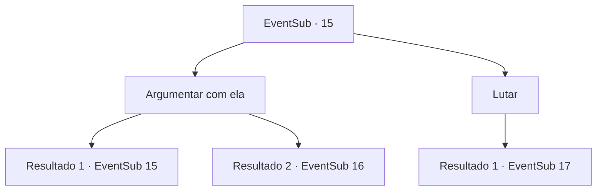

# Eventos secundários · 15

[Índice da tabela](index.md) · [Índice geral](../index.md)

ID: `pt:EventSub:15` · Fonte: `EventSub4` · Versão: 1.2.47.

Mapeamento estático dos arquivos; a disponibilidade e a execução dependem do estado da run.

## Texto do evento

*Sem texto no arquivo.*

## Dados de entrada

```json
{
  "id": 15,
  "grade": 1,
  "subEvent": "0",
  "required": ""
}
```

## Mapa das escolhas



## Escolhas e resultados

### Escolha 1

Argumentar com ela

Requisitos e outros campos da escolha:

```json
{
  "required": "5_5_0|1_7_9"
}
```

#### Resultado 1.1

Você tenta convencê-la, mas ela nega firmemente com a cabeça. 

 "Não podem tirar o Johnny de mim."


Continuação registrada: [Evento 15](0015.md) na mesma tabela.

```json
{
  "required": "",
  "chance": "12",
  "nextEvent": 15,
  "type": 1,
  "reward": "5_5_1"
}
```

#### Resultado 1.2

Você diz a ela que a 'ex-namorada' de Johnny está preocupada com ele. É justo, você insiste, que ele retorne à cidade e termine os assuntos com sua ex. A mulher de branco olha para Johnny. Johnny franze a testa e pensa sobre isso antes de acenar. 

 "Sim ... eu deveria ter terminado com ela antes de vir para cá de vez."

 A mulher diz para ele voltar o mais rápido possível, enquanto o abraça com força. Johnny a abraça de volta e promete. 
 Uma hora depois, quando você chega à beira da cidade, Anna vem correndo e abraça Johnny. Ela olha para ele repleta de amor. Johnny, no entanto, a afasta e diz a ela para não procurá -lo. Anna parece atordoada e confusa. Johnny volta para a floresta enquanto Anna observa em choque.

Continuação registrada: [Evento 16](0016.md) na mesma tabela.

```json
{
  "required": "",
  "chance": "1|0_7_1",
  "nextEvent": 16,
  "type": 0,
  "reward": ""
}
```

### Escolha 2

Lutar

Requisitos e outros campos da escolha:

```json
{
  "required": ""
}
```

#### Resultado 2.1

Majet puxa seu arco e você saca sua arma. 

 "Por amor de Deus! Vocês estão loucos?"

 Johnny grita, chocado. De repente, a mulher lança uma rede de sua mão que atinge Majet. Você avança contra ela, arma em mãos.

Continuação registrada: [Evento 17](0017.md) na mesma tabela.

```json
{
  "required": "",
  "chance": "1",
  "nextEvent": 17,
  "type": 2,
  "reward": "6_0_29",
  "place": 6
}
```

## Referências que chegam a este evento

- [Evento 14 · escolha 3 · resultado 1](0014.md#escolha-3)
- [Evento 15 · escolha 1 · resultado 1](0015.md#escolha-1)
