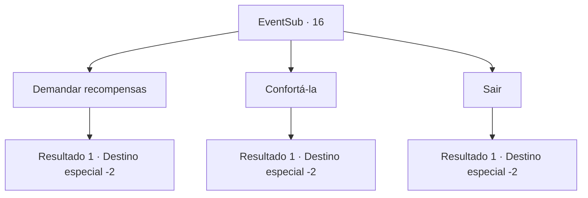

# Eventos secundários · 16

[Índice da tabela](index.md) · [Índice geral](../index.md)

ID: `pt:EventSub:16` · Fonte: `EventSub4` · Versão: 1.2.47.

Mapeamento estático dos arquivos; a disponibilidade e a execução dependem do estado da run.

## Texto do evento

*Sem texto no arquivo.*

## Dados de entrada

```json
{
  "id": 16,
  "grade": 1,
  "subEvent": "0",
  "required": ""
}
```

## Mapa das escolhas



## Escolhas e resultados

### Escolha 1

Demandar recompensas

Requisitos e outros campos da escolha:

```json
{
  "required": ""
}
```

#### Resultado 1.1

Você pede recompensas a Anna. Ela te dá um olhar vazio. 

 "Pegue isso..."

 Ela tira o anel do dedo e te dá. Ela continua olhando para Johnny enquanto desaparece ao longe. Você a deixa em paz e segue em frente.

Continuação registrada: [Destino especial `-2`](../destinos-especiais.md).

```json
{
  "required": "",
  "chance": "1",
  "nextEvent": -2,
  "type": 2,
  "reward": "3_46_1|0_2_3|12_0_-1|5_17_2|14_0_0"
}
```

### Escolha 2

Confortá-la

Requisitos e outros campos da escolha:

```json
{
  "required": ""
}
```

#### Resultado 2.1

Você conforta Anna. Ela lamenta por horas enquanto chora. Ela olha para você com os olhos inchados enquanto fala. 

 "Talvez seja melhor assim... Eu não tinha ideia de quem ele era... Espero que aquele idiota morra naquela floresta."

 Ela tira o anel do dedo e depois te dá. Ela também te dá um pequeno bolso cheio de dinheiro em espécie. Você dividem os lucros com Majet.

Continuação registrada: [Destino especial `-2`](../destinos-especiais.md).

```json
{
  "required": "",
  "chance": "1",
  "nextEvent": -2,
  "type": 2,
  "reward": "3_46_1|0_2_3|0_4_30|12_0_-1|5_17_2|14_0_0"
}
```

### Escolha 3

Sair

Requisitos e outros campos da escolha:

```json
{
  "required": ""
}
```

#### Resultado 3.1

Não parece certo pedir algo dela. Você sai com Majet e deixa Anna em paz. Majet sugere tomarem uma bebida juntos.

Continuação registrada: [Destino especial `-2`](../destinos-especiais.md).

```json
{
  "required": "",
  "chance": "1",
  "nextEvent": -2,
  "type": 2,
  "reward": "12_0_-1|5_17_2|14_0_0"
}
```

## Referências que chegam a este evento

- [Evento 15 · escolha 1 · resultado 2](0015.md#escolha-1)
