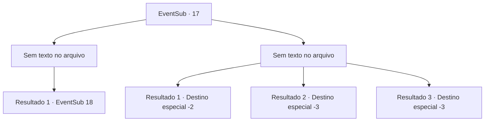

# Eventos secundários · 17

[Índice da tabela](index.md) · [Índice geral](../index.md)

ID: `pt:EventSub:17` · Fonte: `EventSub4` · Versão: 1.2.47.

Mapeamento estático dos arquivos; a disponibilidade e a execução dependem do estado da run.

## Texto do evento

*Sem texto no arquivo.*

## Dados de entrada

```json
{
  "id": 17,
  "grade": 1,
  "subEvent": "0",
  "required": ""
}
```

## Mapa das escolhas



## Escolhas e resultados

### Escolha 1

*Sem texto no arquivo; o papel dessa opção depende da interface do jogo.*

Requisitos e outros campos da escolha:

```json
{
  "required": ""
}
```

#### Resultado 1.1

A mulher de branco respira com dificuldade. Johnny coloca-se na frente dela para te impedir. Ele concorda em voltar para a cidade se prometerem deixá-la em paz.

Continuação registrada: [Evento 18](0018.md) na mesma tabela.

```json
{
  "required": "",
  "chance": "1",
  "nextEvent": 18,
  "type": 2,
  "reward": ""
}
```

### Escolha 2

*Sem texto no arquivo; o papel dessa opção depende da interface do jogo.*

Requisitos e outros campos da escolha:

```json
{
  "required": ""
}
```

#### Resultado 2.1

A mulher lhe golpeia e você desmaia. Ela dá um aviso final. 

 "Nunca mais mexa conosco."

 Você e Majet não têm escolha a não ser voltar à cidade. Você retorna pra Anna e diz a ela que não conseguiram encontrar Johnny em lugar nenhum. Você também a alerta para não chegar perto da Floresta das Aranhas, pois é muito perigosa. Anna concorda, mas ela não parece acreditar em você. Você a deixa em paz e sai da cidade.

Continuação registrada: [Destino especial `-2`](../destinos-especiais.md).

```json
{
  "required": "1_0_2|1_1_2",
  "chance": "1",
  "nextEvent": -2,
  "type": 2,
  "reward": "0_0_-1|0_1_-1|0_2_3|12_0_-1|14_0_1"
}
```

#### Resultado 2.2

A mulher lhe golpeia e você desmaia. Pra nunca mais se levantar.

Continuação registrada: [Destino especial `-3`](../destinos-especiais.md).

```json
{
  "required": "2_0_2",
  "chance": "1",
  "nextEvent": -3,
  "type": 2,
  "reward": "0_0_-1|0_1_-1"
}
```

#### Resultado 2.3

A mulher lhe golpeia e você desmaia. Pra nunca mais se levantar.

Continuação registrada: [Destino especial `-3`](../destinos-especiais.md).

```json
{
  "required": "2_1_2",
  "chance": "1",
  "nextEvent": -3,
  "type": 2,
  "reward": "0_0_-1|0_1_-1"
}
```

## Referências que chegam a este evento

- [Evento 15 · escolha 2 · resultado 1](0015.md#escolha-2)
