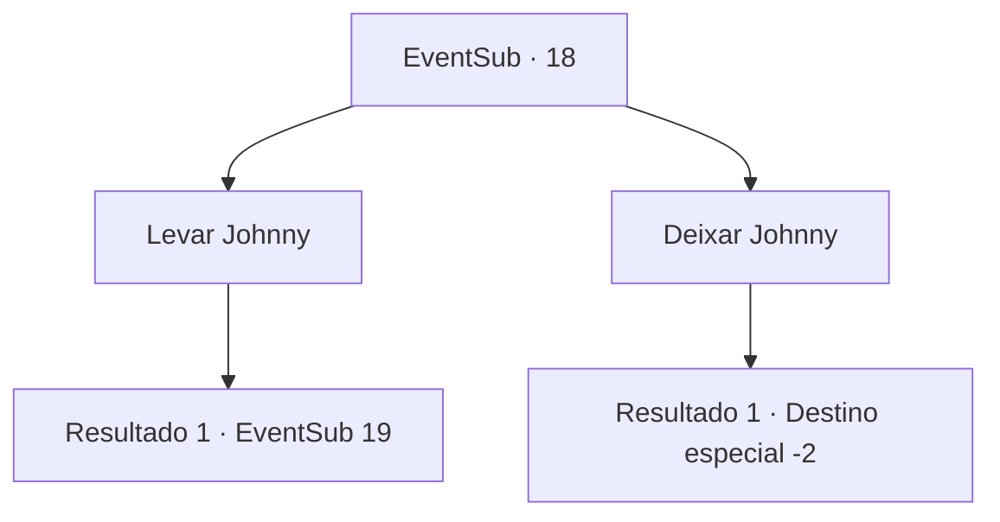

# Eventos secundários · 18

[Índice da tabela](index.md) · [Índice geral](../index.md)

ID: `pt:EventSub:18` · Fonte: `EventSub4` · Versão: 1.2.47.

Mapeamento estático dos arquivos; a disponibilidade e a execução dependem do estado da run.

## Texto do evento

*Sem texto no arquivo.*

## Dados de entrada

```json
{
  "id": 18,
  "grade": 1,
  "subEvent": "0",
  "required": ""
}
```

## Mapa das escolhas



## Escolhas e resultados

### Escolha 1

Levar Johnny

Requisitos e outros campos da escolha:

```json
{
  "required": ""
}
```

#### Resultado 1.1

Assim que você alcanca o Johnny, ele voa para trás. A mulher o lança pra trás e olha para você enquanto fala. 

 "VOCÊS! NÃO! LEVARÃO! O! JOHNNY!"|drawing_spiderTransform| A linda mulher se foi, e em seu lugar estava uma aranha gigante. Johnny congela com o choque.

Continuação registrada: [Evento 19](0019.md) na mesma tabela.

```json
{
  "required": "",
  "chance": "1",
  "nextEvent": 19,
  "type": 2,
  "reward": "6_0_30",
  "place": 6
}
```

### Escolha 2

Deixar Johnny

Requisitos e outros campos da escolha:

```json
{
  "required": ""
}
```

#### Resultado 2.1

Você decide deixar Johnny em paz. Você vira e solta Majet da teia. 

 "Você ... tem certeza de que pode viver com esse monstro?"

 Majet resmunga, não concordando completamente em deixá -lo. 
 Você segue o longo caminho de volta à cidade com Majet. Você diz a Anna que não conseguiu encontrar Johnny em lugar nenhum. Anna acena, mas ela não parece acreditar em você. Você a deixa em paz e segue em frente.

Continuação registrada: [Destino especial `-2`](../destinos-especiais.md).

```json
{
  "required": "",
  "chance": "1",
  "nextEvent": -2,
  "type": 2,
  "reward": "0_2_3|12_0_-1|14_0_1"
}
```

## Referências que chegam a este evento

- [Evento 17 · escolha 1 · resultado 1](0017.md#escolha-1)
