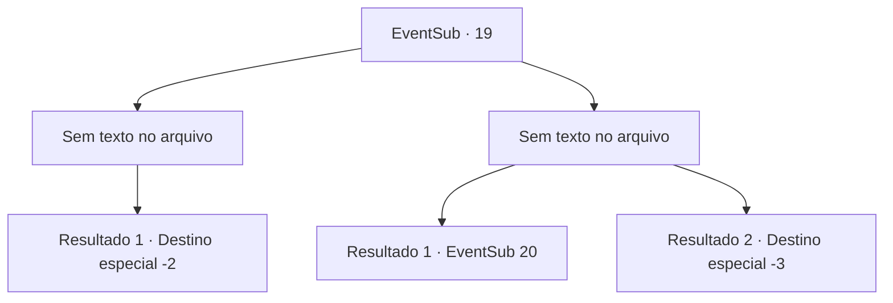

# Eventos secundários · 19

[Índice da tabela](index.md) · [Índice geral](../index.md)

ID: `pt:EventSub:19` · Fonte: `EventSub4` · Versão: 1.2.47.

Mapeamento estático dos arquivos; a disponibilidade e a execução dependem do estado da run.

## Texto do evento

*Sem texto no arquivo.*

## Dados de entrada

```json
{
  "id": 19,
  "grade": 1,
  "subEvent": "0",
  "required": ""
}
```

## Mapa das escolhas



## Escolhas e resultados

### Escolha 1

*Sem texto no arquivo; o papel dessa opção depende da interface do jogo.*

Requisitos e outros campos da escolha:

```json
{
  "required": ""
}
```

#### Resultado 1.1

A aranha gigante cai diante de você. Majet se libertou da teia e agora se aproxima de Johnny. A aranha tenta detê-la, mesmo quase morrendo. Majet hesita. Nesse momento, Johnny pega uma pedra e a esmaga contra a cabeça da aranha. 

 <link=shake> De novo, </link> 

 <link=shake> e de novo, </link> 

 <link=shake> e de novo... </link> 

 Ele não para até que esteja pingando suor. Então ele fica de pé, mancando. 

 "Obrigado ... esse monstro deve ter me possuído. Vamos voltar. Sinto falta de Anna ... sinto muito a falta dela."

 
 Uma hora depois, quando você chega à beira da cidade, Anna vem correndo e abraça Johnny. Eles se olham repletos de amor. Anna agradece a vocês repetidamente. Majet fica pensativa enquanto divide os espólios. 

 "Não tenho certeza se isso terminou bem ..."

 Você os deixa e segue em frente.

Continuação registrada: [Destino especial `-2`](../destinos-especiais.md).

```json
{
  "required": "",
  "chance": "1",
  "nextEvent": -2,
  "type": 2,
  "reward": "0_2_3|0_4_30|12_0_-1|5_17_2|14_0_2"
}
```

### Escolha 2

*Sem texto no arquivo; o papel dessa opção depende da interface do jogo.*

Requisitos e outros campos da escolha:

```json
{
  "required": ""
}
```

#### Resultado 2.1

A aranha gigante agarra você com uma de suas patas dianteiras em forma de braço. Em seguida, mostra suas presas venenosas do tamanho de uma estaca. Justo quando a aranha está prestes a afundá-las, Majet grita de trás. 

 "Deixe-o ir ou você perderá seu homem!"

 Majet se libertou da teia e está segurando Johnny como refém. A aranha te derruba quando vê que Majet está segurando uma lâmina em sua garganta. 

 "Torne-se humano novamente e ajoelhe-se. Agora!"

 A aranha obedece e assume sua forma humana. Em seguida, ela se ajoelha no chão. Ela olha para Majet e Johnny com ansiedade.

Continuação registrada: [Evento 20](0020.md) na mesma tabela.

```json
{
  "required": "1_0_2",
  "chance": "1",
  "nextEvent": 20,
  "type": 2,
  "reward": "0_0_-1"
}
```

#### Resultado 2.2

A aranha gigante te mata.

Continuação registrada: [Destino especial `-3`](../destinos-especiais.md).

```json
{
  "required": "2_0_2",
  "chance": "1",
  "nextEvent": -3,
  "type": 2,
  "reward": "0_0_-1"
}
```

## Referências que chegam a este evento

- [Evento 18 · escolha 1 · resultado 1](0018.md#escolha-1)
