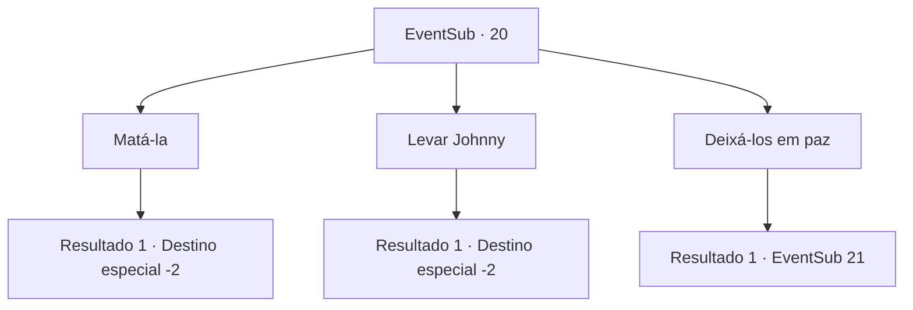

# Eventos secundários · 20

[Índice da tabela](index.md) · [Índice geral](../index.md)

ID: `pt:EventSub:20` · Fonte: `EventSub4` · Versão: 1.2.47.

Mapeamento estático dos arquivos; a disponibilidade e a execução dependem do estado da run.

## Texto do evento

*Sem texto no arquivo.*

## Dados de entrada

```json
{
  "id": 20,
  "grade": 1,
  "subEvent": "0",
  "required": ""
}
```

## Mapa das escolhas



## Escolhas e resultados

### Escolha 1

Matá-la

Requisitos e outros campos da escolha:

```json
{
  "required": ""
}
```

#### Resultado 1.1

Você mata a mulher da aranha. Majet lança Johnny e ele gagueja enquanto fala. 

 "Céus ... ela era uma aranha ... eu ... eu deveria estar possuído. Obrigado por me salvar. Você poderia me levar para casa? Anna ... sinto falta de Anna."

 ... 
 Uma hora depois, quando você chega à beira da cidade, Anna vem correndo e abraça Johnny. Eles se olham repletos de amor. Anna agradece a vocês repetidamente. Majet fica pensativa ao dividir os espólios. 

 "Não tenho certeza se isso terminou bem ..."

 Você os deixa e segue em frente.

Continuação registrada: [Destino especial `-2`](../destinos-especiais.md).

```json
{
  "required": "",
  "chance": "1",
  "nextEvent": -2,
  "type": 2,
  "reward": "0_2_3|0_4_30|0_3_-5|12_0_-1|5_17_2|14_0_2"
}
```

### Escolha 2

Levar Johnny

Requisitos e outros campos da escolha:

```json
{
  "required": ""
}
```

#### Resultado 2.1

Você tira Johnny da caverna, deixando a Mulher Aranha para trás. Majet lança Johnny e ele gagueja enquanto fala. 

 "Céus ... ela era uma aranha ... eu ... eu deveria estar possuído. Obrigado por me salvar. Você poderia me levar para casa? Anna ... sinto falta de Anna."

 ... 
 Uma hora depois, quando você chega à beira da cidade, Anna vem correndo e abraça Johnny. Eles se olham repletos de amor. Majet diz que você deveria ter matado a Mulher Aranha. 

 "Ela pode voltar, sabe ..."

 Você os deixa e segue em frente.

Continuação registrada: [Destino especial `-2`](../destinos-especiais.md).

```json
{
  "required": "",
  "chance": "1",
  "nextEvent": -2,
  "type": 2,
  "reward": "0_2_3|0_4_30|12_0_-1|14_0_3"
}
```

### Escolha 3

Deixá-los em paz

Requisitos e outros campos da escolha:

```json
{
  "required": ""
}
```

#### Resultado 3.1

Você diz a Majet para soltá-lo. Majet parece confusa. Johnny também. Majet faz um gesto para você se aproximar. Então ela sussurra em seu ouvido. 

 "Johnny me pediu para mantê-lo como refém para que ele possa sair daqui"


Continuação registrada: [Evento 21](0021.md) na mesma tabela.

```json
{
  "required": "",
  "chance": "1",
  "nextEvent": 21,
  "type": 2,
  "reward": ""
}
```

## Referências que chegam a este evento

- [Evento 19 · escolha 2 · resultado 1](0019.md#escolha-2)
