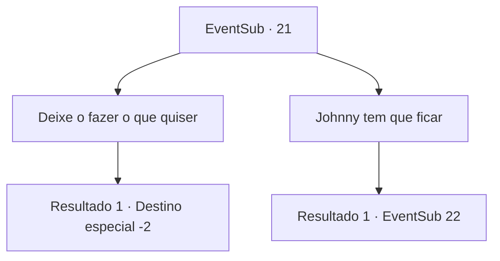

# Eventos secundários · 21

[Índice da tabela](index.md) · [Índice geral](../index.md)

ID: `pt:EventSub:21` · Fonte: `EventSub4` · Versão: 1.2.47.

Mapeamento estático dos arquivos; a disponibilidade e a execução dependem do estado da run.

## Texto do evento

*Sem texto no arquivo.*

## Dados de entrada

```json
{
  "id": 21,
  "grade": 1,
  "subEvent": "0",
  "required": ""
}
```

## Mapa das escolhas



## Escolhas e resultados

### Escolha 1

Deixe o fazer o que quiser

Requisitos e outros campos da escolha:

```json
{
  "required": ""
}
```

#### Resultado 1.1

Você tira Johnny da caverna, deixando a Mulher Aranha para trás. Majet lança Johnny e ele gagueja enquanto fala. 

 "Céus ... ela era uma aranha ... eu ... eu deveria estar possuído. Obrigado por me salvar. Você poderia me levar para casa? Anna ... sinto falta de Anna."

 ... 
 Uma hora depois, quando você chega à beira da cidade, Anna vem correndo e abraça Johnny. Eles se olham repletos de amor. Majet diz que você deveria ter matado a Mulher Aranha. 

 "Ela pode voltar, sabe ..."

 Você os deixa e segue em frente.

Continuação registrada: [Destino especial `-2`](../destinos-especiais.md).

```json
{
  "required": "",
  "chance": "1",
  "nextEvent": -2,
  "type": 2,
  "reward": "0_2_3|0_4_30|12_0_-1|14_0_3"
}
```

### Escolha 2

Johnny tem que ficar

Requisitos e outros campos da escolha:

```json
{
  "required": ""
}
```

#### Resultado 2.1

Você diz a Majet que Johnny precisa ficar na caverna. Ela suspira antes de responder. 

 "O que... te faz pensar assim?"


Continuação registrada: [Evento 22](0022.md) na mesma tabela.

```json
{
  "required": "",
  "chance": "1",
  "nextEvent": 22,
  "type": 2,
  "reward": ""
}
```

## Referências que chegam a este evento

- [Evento 20 · escolha 3 · resultado 1](0020.md#escolha-3)
