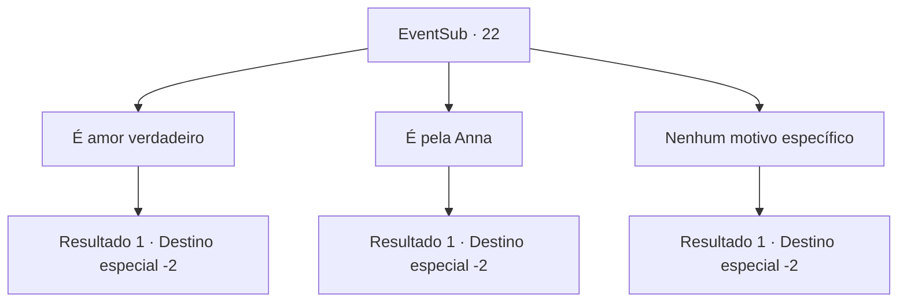

# Eventos secundários · 22

[Índice da tabela](index.md) · [Índice geral](../index.md)

ID: `pt:EventSub:22` · Fonte: `EventSub4` · Versão: 1.2.47.

Mapeamento estático dos arquivos; a disponibilidade e a execução dependem do estado da run.

## Texto do evento

*Sem texto no arquivo.*

## Dados de entrada

```json
{
  "id": 22,
  "grade": 1,
  "subEvent": "0",
  "required": ""
}
```

## Mapa das escolhas



## Escolhas e resultados

### Escolha 1

É amor verdadeiro

Requisitos e outros campos da escolha:

```json
{
  "required": ""
}
```

#### Resultado 1.1

Você explica que sentiu a sinceridade da mulher da aranha, Embora ela possa ser um monstro aos olhos das pessoas. 

 "Romântico na veia, hein? Cada um na sua. Não sei se ele ficará mesmo feliz com esse monstro."

 Ela não esconde seu cinismo enquanto libera Johnny. Você volta para a cidade com ela. 

 Você segue o longo caminho de volta à cidade com Majet. Você diz a Anna que Johnny estava tendo um caso com outra mulher. Anna olha para você em choque. Você a deixa estar e segue em frente.

Continuação registrada: [Destino especial `-2`](../destinos-especiais.md).

```json
{
  "required": "",
  "chance": "1",
  "nextEvent": -2,
  "type": 2,
  "reward": "0_2_3|12_0_-1|5_17_2|14_0_4"
}
```

### Escolha 2

É pela Anna

Requisitos e outros campos da escolha:

```json
{
  "required": ""
}
```

#### Resultado 2.1

Você lembra que Johnny se apaixonou pela aparência da mulher da aranha e traiu Anna. Ele não a merece. Majet concorda com a cabeça. 

 "Você tem razão. Anna merece algo melhor."

 Ela tira o anel de Johnny do dedo dele. Vocês dois vão para a cidade sem ele. 

 Você leva algum tempo para chegar à cidade novamente. Você diz a Anna que Johnny está morto e entrega a ela o anel. Anna explode em lágrimas enquanto segura ele. Você a deixa estar e segue em frente.

Continuação registrada: [Destino especial `-2`](../destinos-especiais.md).

```json
{
  "required": "",
  "chance": "1",
  "nextEvent": -2,
  "type": 2,
  "reward": "0_2_3|12_0_-1|5_17_2|14_0_4"
}
```

### Escolha 3

Nenhum motivo específico

Requisitos e outros campos da escolha:

```json
{
  "required": ""
}
```

#### Resultado 3.1

Você não pode criar um bom motivo. Majet logo fica irritada. 

 "Eu não te entendo, cara ..."

 Então ela leva Johnny e segue em direção à saída. Lá fora, ela o liberta e ele agradece a vocês dois. 

 "Ufa... graças aos céus, enganamos esse monstro. Muito obrigado. Eu devo ter sido possuído. Vamos voltar para a cidade. Anna ... sinto falta de Anna."

 ... 
 Uma hora depois, quando você chega à beira da cidade, Anna vem correndo e abraça Johnny. Eles se olham repletos de amor. Anna agradece que vocês dois repetidamente por salvarem Johnny. Você os deixa e segue em frente.

Continuação registrada: [Destino especial `-2`](../destinos-especiais.md).

```json
{
  "required": "",
  "chance": "1",
  "nextEvent": -2,
  "type": 2,
  "reward": "0_2_3|0_4_30|12_0_-1|14_0_3"
}
```

## Referências que chegam a este evento

- [Evento 21 · escolha 2 · resultado 1](0021.md#escolha-2)
