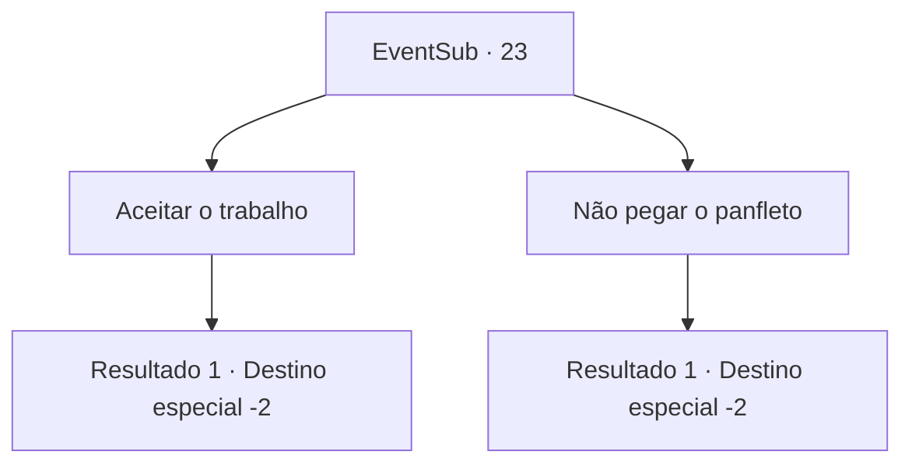

# Eventos secundários · 23

[Índice da tabela](index.md) · [Índice geral](../index.md)

ID: `pt:EventSub:23` · Fonte: `EventSub4` · Versão: 1.2.47.

Mapeamento estático dos arquivos; a disponibilidade e a execução dependem do estado da run.

## Texto do evento

|drawing_board|Você está lendo um quadro de avisos nos arredores de uma cidade chamada 'Garisvan'. Entre os muitos panfletos de oportunidade de empregos, você encontra um interessante. 

 "Por favor, acabe com as batalhas noturnas que acontecem no meu jardim. Eu ficaria feliz em entregar minha herança de família para quem o fizer."


## Dados de entrada

```json
{
  "id": 23,
  "grade": 1,
  "subEvent": "1",
  "required": "12_1_0"
}
```

## Mapa das escolhas



## Escolhas e resultados

### Escolha 1

Aceitar o trabalho

Requisitos e outros campos da escolha:

```json
{
  "required": ""
}
```

#### Resultado 1.1

Você pega os panfletos do quadro e os coloca no bolso. Você vai em busca do cliente.

Continuação registrada: [Destino especial `-2`](../destinos-especiais.md).

```json
{
  "required": "",
  "chance": "1",
  "nextEvent": -2,
  "type": 2,
  "reward": "12_1_1"
}
```

### Escolha 2

Não pegar o panfleto

Requisitos e outros campos da escolha:

```json
{
  "required": ""
}
```

#### Resultado 2.1

Você não aceita o emprego e vai para outro lugar.

Continuação registrada: [Destino especial `-2`](../destinos-especiais.md).

```json
{
  "required": "",
  "chance": "1",
  "nextEvent": -2,
  "type": 2,
  "reward": "12_1_-1"
}
```

## Referências que chegam a este evento

Nenhum `nextEvent` positivo da mesma tabela aponta para este nó. Isso não prova que seja inacessível: sorteio e estado de história podem selecioná-lo.

