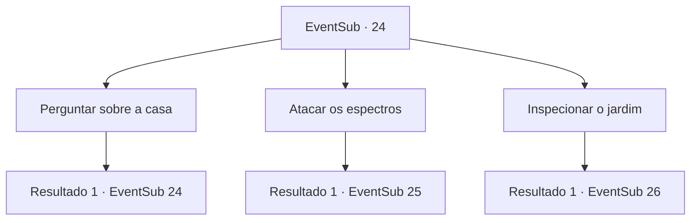

# Eventos secundários · 24

[Índice da tabela](index.md) · [Índice geral](../index.md)

ID: `pt:EventSub:24` · Fonte: `EventSub4` · Versão: 1.2.47.

Mapeamento estático dos arquivos; a disponibilidade e a execução dependem do estado da run.

## Texto do evento

Você usa o folheto como um guia para encontrar seu empregador, Martin. Sua casa é tão grande que leva 20 minutos para ir dos portões, pelo jardim, até a casa. É uma mansão de tijolos bege com teto azul-marinho, cercada por grama verde, flores e um lago com uma fonte de mármore. Martin é um velho, que afirma ter comprado a casa após a aposentadoria. |drawing_mansion| 

 "...Mas eu escolhi a casa errada. Veja por si mesmo quando for a hora."

 Ele parece ficar deprimido só de falar sobre isso. Martin o chama, o sol parece estar se pondo sobre as montanhas. 

 "Está prestes a começar..."

 Assim que o sol se põe, o jardim se torna um campo de batalha. Aparições emergem do chão para lutar entre si. Martin suspira e pede para você se livrar deles.

## Dados de entrada

```json
{
  "id": 24,
  "grade": 1,
  "subEvent": "1",
  "required": "12_1_1|1_2_25"
}
```

## Mapa das escolhas



## Escolhas e resultados

### Escolha 1

Perguntar sobre a casa

Requisitos e outros campos da escolha:

```json
{
  "required": "5_28_0"
}
```

#### Resultado 1.1

Você pergunta a ele sobre a casa. Ele suspira novamente e responde. 

 "Pedi aos meus empregados para fazerem algumas pesquisas sobre essa mansão. Eu deveria ter feito antes de comprá-la, quanta tolice... Acontece que uma pequena batalha ocorreu aqui contra algum país estrangeiro. Esses fantasmas são o que restou de seus soldados... Eu queria cancelar o negócio, mas não pude. Eles se recusaram a devolver meu dinheiro, nem um centavo sequer. Considerei processá-los, mas provavelmente morreria de estresse antes que o tribunal pudesse tomar uma decisão."


Continuação registrada: [Evento 24](0024.md) na mesma tabela.

```json
{
  "required": "",
  "chance": "1",
  "nextEvent": 24,
  "type": 2,
  "reward": "5_28_1"
}
```

### Escolha 2

Atacar os espectros

Requisitos e outros campos da escolha:

```json
{
  "required": ""
}
```

#### Resultado 2.1

Você avança, balançando cegamente sua arma contra os espectros.

Continuação registrada: [Evento 25](0025.md) na mesma tabela.

```json
{
  "required": "",
  "chance": "1",
  "nextEvent": 25,
  "type": 2,
  "reward": "6_0_14",
  "place": 14
}
```

### Escolha 3

Inspecionar o jardim

Requisitos e outros campos da escolha:

```json
{
  "required": ""
}
```

#### Resultado 3.1

Você olha para baixo no jardim a partir da varanda. Os espectros surgem do chão como fumaça e se lançam uns contra os outros. Mas não é uma briga aleatória. Alguns deles estão recebendo ordens de um comandante a cavalo, e suas posturas sugerem treinamento militar. Há dois lados, e o lado com o comandante tem visivelmente menos soldados. Parece que eles estão guardando algo. Mesmo à distância, você sente a vontade excepcionalmente forte do comandante.

Continuação registrada: [Evento 26](0026.md) na mesma tabela.

```json
{
  "required": "",
  "chance": "1",
  "nextEvent": 26,
  "type": 2,
  "reward": ""
}
```

## Referências que chegam a este evento

- [Evento 24 · escolha 1 · resultado 1](0024.md#escolha-1)
