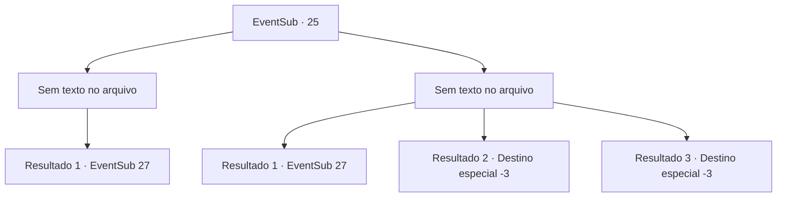

# Eventos secundários · 25

[Índice da tabela](index.md) · [Índice geral](../index.md)

ID: `pt:EventSub:25` · Fonte: `EventSub4` · Versão: 1.2.47.

Mapeamento estático dos arquivos; a disponibilidade e a execução dependem do estado da run.

## Texto do evento

*Sem texto no arquivo.*

## Dados de entrada

```json
{
  "id": 25,
  "grade": 1,
  "subEvent": "1",
  "required": ""
}
```

## Mapa das escolhas



## Escolhas e resultados

### Escolha 1

*Sem texto no arquivo; o papel dessa opção depende da interface do jogo.*

Requisitos e outros campos da escolha:

```json
{
  "required": ""
}
```

#### Resultado 1.1

Você luta contra os espectros a noite toda. Eles desaparecem quando o sol nasce, e você fica sozinho no jardim. Os servos vêm correndo e perguntam se você está bem. Eles parecem surpresos que você tenha passado a noite toda. Martin chega e suspira. 

 "Tanto quanto eu aprecio sua coragem, eles voltarão amanhã à noite de qualquer maneira então poupe-se do trabalho. Se você não conseguir se livrar deles, eu posso sempre contratar alguém que possa, ou vender esta casa maldita."

 Ele te entrega um pequeno bilhete. 

 "Um é o endereço da minha imobiliária, e o outro é o de um padre famoso. Você decide."


Continuação registrada: [Evento 27](0027.md) na mesma tabela.

```json
{
  "required": "",
  "chance": "1",
  "nextEvent": 27,
  "type": 2,
  "reward": "0_1_-1"
}
```

### Escolha 2

*Sem texto no arquivo; o papel dessa opção depende da interface do jogo.*

Requisitos e outros campos da escolha:

```json
{
  "required": ""
}
```

#### Resultado 2.1

Você desmaia enquanto luta contra os espectros. Você acorda para se encontrar em uma cama confortável. O velho sentado ao seu lado suspira. 

 "Por mais que eu aprecie sua coragem, eles voltarão amanhã à noite de qualquer maneira, então poupe-se do problema. Se você não conseguir se livrar deles, eu sempre posso contratar outra pessoa que possa, ou vender esta casa maldita."

 Ele lhe entrega um pequeno bilhete. 

 "Um é o endereço da minha imobiliária e o outro é o de um famoso padre. Você decide."


Continuação registrada: [Evento 27](0027.md) na mesma tabela.

```json
{
  "required": "1_0_2|1_1_2",
  "chance": "1",
  "nextEvent": 27,
  "type": 2,
  "reward": "0_0_-1|0_1_-1"
}
```

#### Resultado 2.2

Você desmaia enquanto luta contra os espectros. Você nunca se levanta novamente.

Continuação registrada: [Destino especial `-3`](../destinos-especiais.md).

```json
{
  "required": "2_0_2",
  "chance": "1",
  "nextEvent": -3,
  "type": 2,
  "reward": "0_0_-1|0_1_-1"
}
```

#### Resultado 2.3

Você desmaia enquanto luta contra os espectros. Você nunca se levanta novamente.

Continuação registrada: [Destino especial `-3`](../destinos-especiais.md).

```json
{
  "required": "2_1_2",
  "chance": "1",
  "nextEvent": -3,
  "type": 2,
  "reward": "0_0_-1|0_1_-1"
}
```

## Referências que chegam a este evento

- [Evento 24 · escolha 2 · resultado 1](0024.md#escolha-2)
