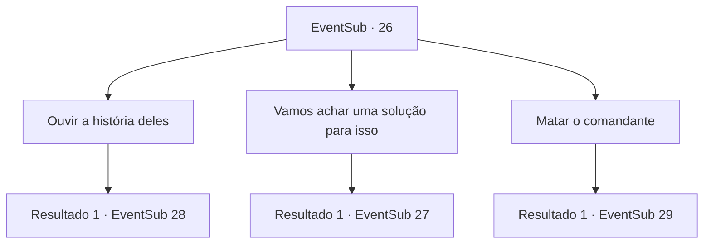

# Eventos secundários · 26

[Índice da tabela](index.md) · [Índice geral](../index.md)

ID: `pt:EventSub:26` · Fonte: `EventSub4` · Versão: 1.2.47.

Mapeamento estático dos arquivos; a disponibilidade e a execução dependem do estado da run.

## Texto do evento

*Sem texto no arquivo.*

## Dados de entrada

```json
{
  "id": 26,
  "grade": 1,
  "subEvent": "1",
  "required": ""
}
```

## Mapa das escolhas



## Escolhas e resultados

### Escolha 1

Ouvir a história deles

Requisitos e outros campos da escolha:

```json
{
  "required": ""
}
```

#### Resultado 1.1

Você se aproxima do comandante determinado e fala. Ele grita de volta, surpreso. 

 "O que você está fazendo aqui, civil? É muito perigoso, evacue antes que seja tarde demais. Essa área está sob nosso controle."

 Você pergunta a ele o que está acontecendo. Ele responde entre seus comandos ocupados. 

 "Estávamos transportando suprimentos das Grandes Colinas para o Rio Falleast quando fomos emboscados. Tenho trabalho a fazer, então pare de fazer perguntas e vá para um lugar seguro."


Continuação registrada: [Evento 28](0028.md) na mesma tabela.

```json
{
  "required": "",
  "chance": "1",
  "nextEvent": 28,
  "type": 2,
  "reward": ""
}
```

### Escolha 2

Vamos achar uma solução  para isso

Requisitos e outros campos da escolha:

```json
{
  "required": ""
}
```

#### Resultado 2.1

Você decide buscar uma alternativa á luta. Quando você pergunta a Martin o que ele prefere, o velho responde. 

 "Seria melhor para todos aqueles espectros descansarem em paz, para que parem de aparecer no meu jardim. Mas eu sempre posso vender esta casa maldita se as coisas não derem certo."

 Ele te entrega um pequeno bilhete. 

 "Um é o endereço da minha imobiliária e o outro é o de um padre famoso. Você decide."


Continuação registrada: [Evento 27](0027.md) na mesma tabela.

```json
{
  "required": "",
  "chance": "1",
  "nextEvent": 27,
  "type": 2,
  "reward": ""
}
```

### Escolha 3

Matar o comandante

Requisitos e outros campos da escolha:

```json
{
  "required": ""
}
```

#### Resultado 3.1

Você se aproxima do comandante determinado e fala. Ele grita de volta, surpreso. 

 "O que você está fazendo aqui, civil? É muito perigoso, evacue antes que seja tarde demais. Essa área está sob nosso controle."

 Você saca sua arma e o ataca. Ele defende seu ataque e fala. 

 "Então você é um inimigo disfarçado. Quase me pegou lá..."

 O comandante balança sua espada, seu rosto brilhando com um olhar sinistro.

Continuação registrada: [Evento 29](0029.md) na mesma tabela.

```json
{
  "required": "",
  "chance": "1",
  "nextEvent": 29,
  "type": 2,
  "reward": "6_0_54",
  "place": 14
}
```

## Referências que chegam a este evento

- [Evento 24 · escolha 3 · resultado 1](0024.md#escolha-3)
