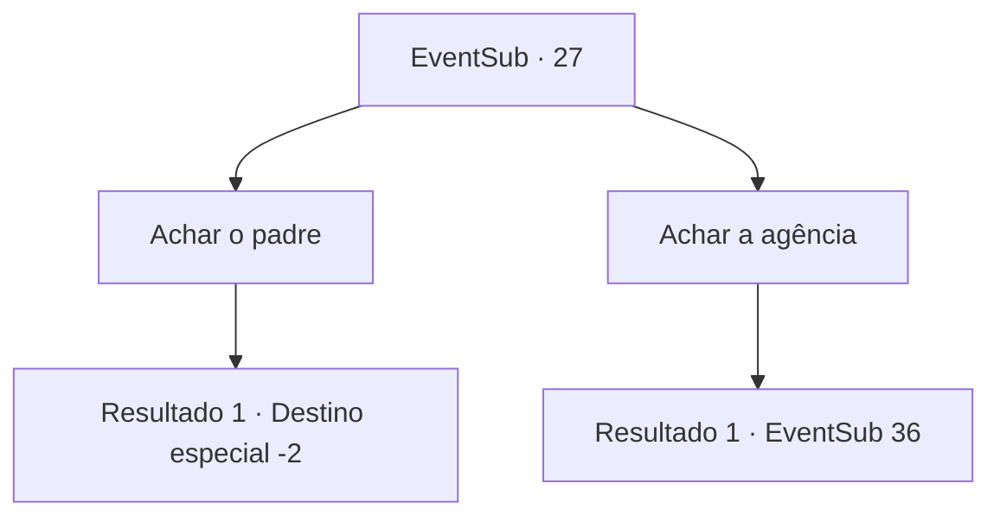

# Eventos secundários · 27

[Índice da tabela](index.md) · [Índice geral](../index.md)

ID: `pt:EventSub:27` · Fonte: `EventSub4` · Versão: 1.2.47.

Mapeamento estático dos arquivos; a disponibilidade e a execução dependem do estado da run.

## Texto do evento

*Sem texto no arquivo.*

## Dados de entrada

```json
{
  "id": 27,
  "grade": 1,
  "subEvent": "1",
  "required": ""
}
```

## Mapa das escolhas



## Escolhas e resultados

### Escolha 1

Achar o padre

Requisitos e outros campos da escolha:

```json
{
  "required": ""
}
```

#### Resultado 1.1

Você vai procurar um padre que possa cuidar dos espectros. Martin diz para procurar um padre chamado 'Harda' em uma cidade chamada 'Gabram'. Você deixa a cidade para procurar o padre.

Continuação registrada: [Destino especial `-2`](../destinos-especiais.md).

```json
{
  "required": "",
  "chance": "1",
  "nextEvent": -2,
  "type": 2,
  "reward": "12_1_2"
}
```

### Escolha 2

Achar a agência

Requisitos e outros campos da escolha:

```json
{
  "required": ""
}
```

#### Resultado 2.1

Você decide visitar a agência imobiliária de Martin. Ele diz que comprou a casa na 'Agência do Tholes', localizada no distrito comercial central de Garisvan. Você vai em direção à agência imobiliária Martin falou sobre. 

 O agente imobiliário, Tholes, esfrega as mãos enquanto ele lhe cumprimenta. Você diz a ele para reembolsar a casa que ele vendeu para Martin porque os fantasmas estão aparecendo lá. No entanto, Tholes afirma que não havia falhas no contrato, E que ele não sabia sobre os fantasmas, portanto não concorda com o reembolso.

Continuação registrada: [Evento 36](0036.md) na mesma tabela.

```json
{
  "required": "",
  "chance": "1",
  "nextEvent": 36,
  "type": 2,
  "reward": "12_1_3"
}
```

## Referências que chegam a este evento

- [Evento 25 · escolha 1 · resultado 1](0025.md#escolha-1)
- [Evento 25 · escolha 2 · resultado 1](0025.md#escolha-2)
- [Evento 26 · escolha 2 · resultado 1](0026.md#escolha-2)
