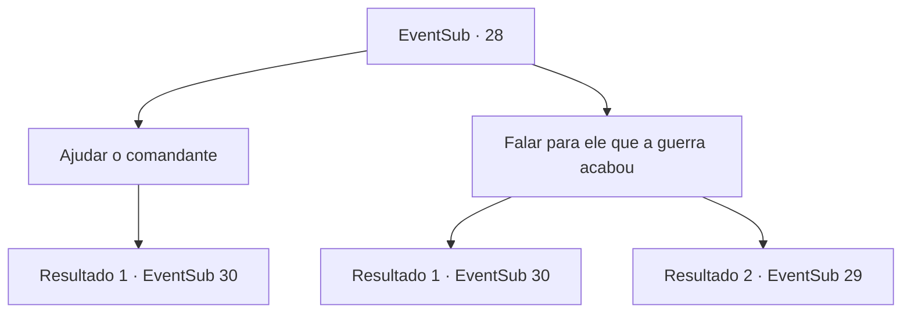

# Eventos secundários · 28

[Índice da tabela](index.md) · [Índice geral](../index.md)

ID: `pt:EventSub:28` · Fonte: `EventSub4` · Versão: 1.2.47.

Mapeamento estático dos arquivos; a disponibilidade e a execução dependem do estado da run.

## Texto do evento

*Sem texto no arquivo.*

## Dados de entrada

```json
{
  "id": 28,
  "grade": 1,
  "subEvent": "1",
  "required": ""
}
```

## Mapa das escolhas



## Escolhas e resultados

### Escolha 1

Ajudar o comandante

Requisitos e outros campos da escolha:

```json
{
  "required": ""
}
```

#### Resultado 1.1

Você oferece ajuda ao comandante. Seu brilho sinistro diminui. 

 "Hmph... Vá em frente então! Ajude aquele esquadrão ali."

 E com isso, ele virou seu cavalo e avançou contra um espectro que se aproximava.

Continuação registrada: [Evento 30](0030.md) na mesma tabela.

```json
{
  "required": "",
  "chance": "1",
  "nextEvent": 30,
  "type": 2,
  "reward": "6_0_78",
  "place": 14
}
```

### Escolha 2

Falar para ele que a guerra acabou

Requisitos e outros campos da escolha:

```json
{
  "required": "5_28_1|1_7_9"
}
```

#### Resultado 2.1

Você tenta argumentar com o comandante. Explica a ele que a guerra acabou e não há necessidade de lutar. O comandante baixa lentamente a sua espada. Ele desaba de joelhos, incrédulo. 

 "...Então a guerra acabou e eu já estou morto? Não foi apenas um ciclo?"

 Ele abana a cabeça enquanto fala palavras sem sentido. Ele parece estar em choque. 

 "Não posso desistir agora. Mesmo que esteja morto, mesmo que tudo isto tenha acabado. Por favor, ajuda-me."

 Parece que ele não vai parar até vencer. Você não tem escolha senão lutar ao lado dele.

Continuação registrada: [Evento 30](0030.md) na mesma tabela.

```json
{
  "required": "",
  "chance": "1|0_7_1",
  "nextEvent": 30,
  "type": 0,
  "reward": "6_0_78",
  "place": 14
}
```

#### Resultado 2.2

Você explica a ele que a guerra acabou e não há necessidade de lutar. Suas palavras o enfurecem e ele balança sua espada em sua direção.

Continuação registrada: [Evento 29](0029.md) na mesma tabela.

```json
{
  "required": "",
  "chance": "20",
  "nextEvent": 29,
  "type": 1,
  "reward": "6_0_54",
  "place": 14
}
```

## Referências que chegam a este evento

- [Evento 26 · escolha 1 · resultado 1](0026.md#escolha-1)
