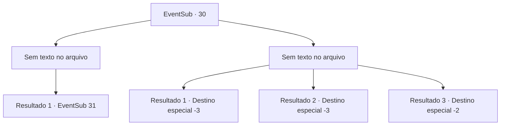

# Eventos secundários · 30

[Índice da tabela](index.md) · [Índice geral](../index.md)

ID: `pt:EventSub:30` · Fonte: `EventSub4` · Versão: 1.2.47.

Mapeamento estático dos arquivos; a disponibilidade e a execução dependem do estado da run.

## Texto do evento

*Sem texto no arquivo.*

## Dados de entrada

```json
{
  "id": 30,
  "grade": 1,
  "subEvent": "1",
  "required": ""
}
```

## Mapa das escolhas



## Escolhas e resultados

### Escolha 1

*Sem texto no arquivo; o papel dessa opção depende da interface do jogo.*

Requisitos e outros campos da escolha:

```json
{
  "required": ""
}
```

#### Resultado 1.1

Você luta contra os espectros até o amanhecer. Você consegue derrotar todos os inimigos do comandante. Ele levanta a espada e grita para seus soldados. <link=shake> 

 "Nós ... ganhamos !!"

 </link> Os outros comemoram. O comandante agradece e desaparece no ar. Martin corre para o jardim para agradecer. 

 "Você conseguiu...! O sol ainda não nasceu e todos eles se foram! Hahah! Você é uma figura, hein?"

 Como ele prometeu, ele pergunta o que você quer em troca.

Continuação registrada: [Evento 31](0031.md) na mesma tabela.

```json
{
  "required": "",
  "chance": "1",
  "nextEvent": 31,
  "type": 2,
  "reward": "14_1_0|12_1_-1"
}
```

### Escolha 2

*Sem texto no arquivo; o papel dessa opção depende da interface do jogo.*

Requisitos e outros campos da escolha:

```json
{
  "required": ""
}
```

#### Resultado 2.1

Você é encontrado morto no jardim ao amanhecer.

Continuação registrada: [Destino especial `-3`](../destinos-especiais.md).

```json
{
  "required": "2_1_2",
  "chance": "1",
  "nextEvent": -3,
  "type": 2,
  "reward": "0_0_-1|0_1_-1"
}
```

#### Resultado 2.2

Você é encontrado morto no jardim ao amanhecer.

Continuação registrada: [Destino especial `-3`](../destinos-especiais.md).

```json
{
  "required": "2_0_2",
  "chance": "1",
  "nextEvent": -3,
  "type": 2,
  "reward": "0_0_-1|0_1_-1"
}
```

#### Resultado 2.3

Você não é páreo para os espectros e acaba desmaiando durante a luta. Você acorda na casa de Martin. Ele te entrega um pouco de dinheiro. 

 "Obrigado... Agradeço seus esforços, mas terei que encontrar outra pessoa para o trabalho."

 Você falhou no trabalho.

Continuação registrada: [Destino especial `-2`](../destinos-especiais.md).

```json
{
  "required": "1_0_2|1_1_2",
  "chance": "1",
  "nextEvent": -2,
  "type": 2,
  "reward": "0_4_10|0_1_-1|0_0_-1|12_1_-1|0_2_1"
}
```

## Referências que chegam a este evento

- [Evento 28 · escolha 1 · resultado 1](0028.md#escolha-1)
- [Evento 28 · escolha 2 · resultado 1](0028.md#escolha-2)
