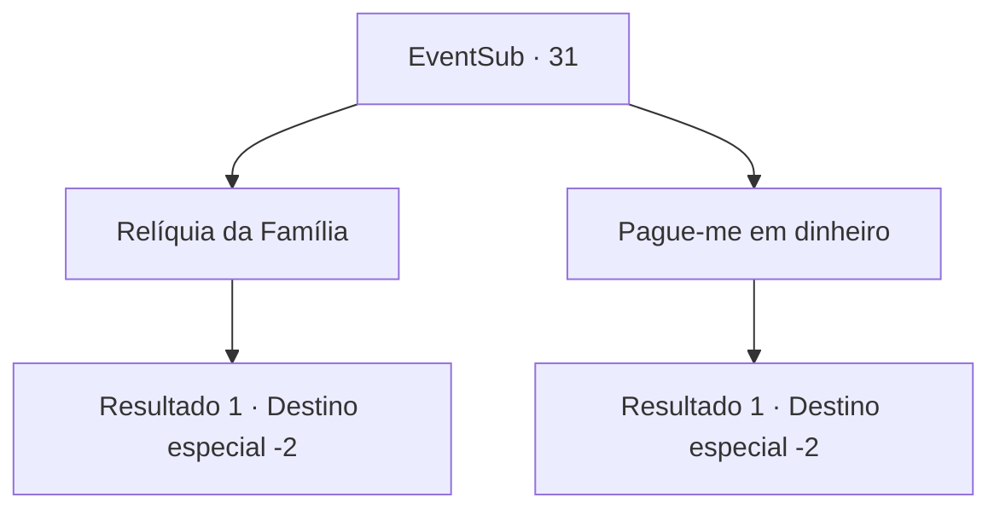

# Eventos secundários · 31

[Índice da tabela](index.md) · [Índice geral](../index.md)

ID: `pt:EventSub:31` · Fonte: `EventSub4` · Versão: 1.2.47.

Mapeamento estático dos arquivos; a disponibilidade e a execução dependem do estado da run.

## Texto do evento

*Sem texto no arquivo.*

## Dados de entrada

```json
{
  "id": 31,
  "grade": 1,
  "subEvent": "1",
  "required": ""
}
```

## Mapa das escolhas



## Escolhas e resultados

### Escolha 1

Relíquia da Família

Requisitos e outros campos da escolha:

```json
{
  "required": ""
}
```

#### Resultado 1.1

Você pede a relíquia de família. Martin manda um servo trazer a armadura que pendia de uma das paredes. Ele a olha com orgulho e explica. 

 "Isso costumava pertencer ao meu avô. Espero que você faça bom uso dela."

 A armadura está em ótimo estado para sua idade. Você a pega e continua em sua jornada.

Continuação registrada: [Destino especial `-2`](../destinos-especiais.md).

```json
{
  "required": "",
  "chance": "1",
  "nextEvent": -2,
  "type": 2,
  "reward": "3_107_1|0_2_4|12_1_-1"
}
```

### Escolha 2

Pague-me em dinheiro

Requisitos e outros campos da escolha:

```json
{
  "required": ""
}
```

#### Resultado 2.1

Você pede pagamento em dinheiro. Martin manda um servo trazer um baú. Está cheio de ouro. Você pega o dinheiro e continua sua jornada.

Continuação registrada: [Destino especial `-2`](../destinos-especiais.md).

```json
{
  "required": "",
  "chance": "1",
  "nextEvent": -2,
  "type": 2,
  "reward": "0_4_250|0_2_4|12_1_-1"
}
```

## Referências que chegam a este evento

- [Evento 29 · escolha 1 · resultado 1](0029.md#escolha-1)
- [Evento 30 · escolha 1 · resultado 1](0030.md#escolha-1)
- [Evento 32 · escolha 2 · resultado 1](0032.md#escolha-2)
- [Evento 35 · escolha 1 · resultado 1](0035.md#escolha-1)
