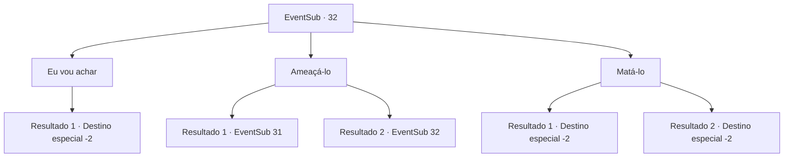

# Eventos secundários · 32

[Índice da tabela](index.md) · [Índice geral](../index.md)

ID: `pt:EventSub:32` · Fonte: `EventSub4` · Versão: 1.2.47.

Mapeamento estático dos arquivos; a disponibilidade e a execução dependem do estado da run.

## Texto do evento

Você usa a nota de Martin como seu guia para encontrar o famoso padre 'Harda'. Harda está rezando na sinagoga.|drawing_pray|Você conta a ele sobre o jardim assombrado de Martin e pede sua ajuda. 

 "Isso é muito lamentável. Mas temo que haja pouco que eu possa fazer."

 Ele lhe diz que perdeu um importante pertence seu e não pode ir a lugar nenhum porque tem que orar por perdão.

## Dados de entrada

```json
{
  "id": 32,
  "grade": 1,
  "subEvent": "1",
  "required": "12_1_2|1_2_35"
}
```

## Mapa das escolhas



## Escolhas e resultados

### Escolha 1

Eu vou achar

Requisitos e outros campos da escolha:

```json
{
  "required": ""
}
```

#### Resultado 1.1

Você diz a ele que poderia encontrá-lo para ele. Ele sorri e agradece. Então ele arranca um pedaço de papel e desenha para você o colar perdido e um mapa. 

 "Eu estava dando um passeio ao ar livre e quando voltei, ele tinha desaparecido. Você deveria ser capaz de encontrar um antigo santuário se seguir meu caminho."

 Ele percorreu uma grande distância de acordo com o mapa. Ele aperta sua mão e deseja boa sorte. É tarde demais para dizer não, então você parte em busca do colar.

Continuação registrada: [Destino especial `-2`](../destinos-especiais.md).

```json
{
  "required": "",
  "chance": "1",
  "nextEvent": -2,
  "type": 2,
  "reward": "0_2_1|12_1_4"
}
```

### Escolha 2

Ameaçá-lo

Requisitos e outros campos da escolha:

```json
{
  "required": "5_35_0"
}
```

#### Resultado 2.1

Você ameaça o padre. Tremendo, ele se oferece para dizer como chegar lá, já que ele não pode ir mesmo. 

 "Reúna todos os corpos do jardim em um só lugar e dê a eles um funeral."

 Você volta para a casa de Martin depois de ouvir isso. 

 O velho sauda seu retorno. Você e os servos desenterram o jardim com sua permissão. Você encontra centenas de restos humanos. Você os reúne em algum lugar longe da mansão e dá a eles um bom funeral. 

 O jardim está livre de espectros esta noite. Martin está satisfeito e ele pergunta o que você quer em troca.

Continuação registrada: [Evento 31](0031.md) na mesma tabela.

```json
{
  "required": "",
  "chance": "1|0_12_1",
  "nextEvent": 31,
  "type": 0,
  "reward": "0_3_-1|12_1_-1|14_1_1"
}
```

#### Resultado 2.2

Você ameaça o padre. Ele zomba e responde. 

 "Suas ameaças não vão funcionar comigo."

 Ele começa a rezar novamente.

Continuação registrada: [Evento 32](0032.md) na mesma tabela.

```json
{
  "required": "",
  "chance": "10",
  "nextEvent": 32,
  "type": 1,
  "reward": "5_35_1"
}
```

### Escolha 3

Matá-lo

Requisitos e outros campos da escolha:

```json
{
  "required": "2_3_0|5_35_1"
}
```

#### Resultado 3.1

Você mata o padre que estava concentrado em sua oração. Felizmente, não há ninguém por perto para testemunhar seu crime. Mas agora você precisa ir à imobiliária para completar a missão do velho.

Continuação registrada: [Destino especial `-2`](../destinos-especiais.md).

```json
{
  "required": "18_37_2",
  "chance": "1",
  "nextEvent": -2,
  "type": 2,
  "reward": "0_3_-10|12_1_3|5_35_2|0_2_1"
}
```

#### Resultado 3.2

Você mata o padre que estava focado em sua oração. Felizmente, ninguém está por perto para testemunhar seu crime. No entanto, agora não lhe restam modos de completar a busca do velho.

Continuação registrada: [Destino especial `-2`](../destinos-especiais.md).

```json
{
  "required": "5_37_2",
  "chance": "1",
  "nextEvent": -2,
  "type": 2,
  "reward": "0_3_-10|12_1_-1|0_2_1|14_1_3"
}
```

## Referências que chegam a este evento

- [Evento 32 · escolha 2 · resultado 2](0032.md#escolha-2)
