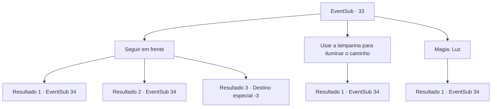

# Eventos secundários · 33

[Índice da tabela](index.md) · [Índice geral](../index.md)

ID: `pt:EventSub:33` · Fonte: `EventSub4` · Versão: 1.2.47.

Mapeamento estático dos arquivos; a disponibilidade e a execução dependem do estado da run.

## Texto do evento

|drawing_sanctuary| Você chega ao santuário que Harda lhe falou. O santuário foi abandonado há muito tempo, então parece que não há mais ninguém lá. Você entra no santuário para procurar o item solicitado pelo padre.

## Dados de entrada

```json
{
  "id": 33,
  "grade": 1,
  "subEvent": "1",
  "required": "12_1_4|1_2_55"
}
```

## Mapa das escolhas



## Escolhas e resultados

### Escolha 1

Seguir em frente

Requisitos e outros campos da escolha:

```json
{
  "required": ""
}
```

#### Resultado 1.1

O santuário está escuro, mas é suficientemente iluminado para navegar devido ao musgo brilhante. Então você continua seu caminho para dentro e se depara com uma câmara ampla. No meio da câmara há um altar cercado por estátuas de pedra.

Continuação registrada: [Evento 34](0034.md) na mesma tabela.

```json
{
  "required": "20_26_1",
  "chance": "1",
  "nextEvent": 34,
  "type": 2,
  "reward": ""
}
```

#### Resultado 1.2

O santuário está escuro e você não consegue ver nada. Eventualmente, você tropeça e cai. Após rolar escada abaixo, você se encontra em uma câmara ampla. No meio da câmara, há um altar cercado por estátuas de pedra.

Continuação registrada: [Evento 34](0034.md) na mesma tabela.

```json
{
  "required": "1_0_2|21_26_1",
  "chance": "1",
  "nextEvent": 34,
  "type": 2,
  "reward": "0_0_-1"
}
```

#### Resultado 1.3

O santuário está escuro e você não consegue ver nada. Eventualmente você tropeça e cai. Você perde a consciência.

Continuação registrada: [Destino especial `-3`](../destinos-especiais.md).

```json
{
  "required": "2_0_2|21_26_1",
  "chance": "1",
  "nextEvent": -3,
  "type": 2,
  "reward": "0_0_-1"
}
```

### Escolha 2

Usar a lamparina para  iluminar o caminho

Requisitos e outros campos da escolha:

```json
{
  "required": "8_42_1"
}
```

#### Resultado 2.1

Você tira a lanterna para iluminar o santuário escuro. Então você continua seu caminho para dentro e se depara com uma câmara ampla. No meio da câmara há um altar cercado por estátuas de pedra.

Continuação registrada: [Evento 34](0034.md) na mesma tabela.

```json
{
  "required": "",
  "chance": "1",
  "nextEvent": 34,
  "type": 2,
  "reward": ""
}
```

### Escolha 3

Magia: Luz

Requisitos e outros campos da escolha:

```json
{
  "required": "20_0_1"
}
```

#### Resultado 3.1

Você conjura um feitiço de luz para iluminar o santuário escuro. Em seguida, você continua seu caminho para dentro e se depara com uma câmara ampla. No meio da câmara, há um altar cercado por estátuas de pedra.

Continuação registrada: [Evento 34](0034.md) na mesma tabela.

```json
{
  "required": "",
  "chance": "1",
  "nextEvent": 34,
  "type": 2,
  "reward": ""
}
```

## Referências que chegam a este evento

Nenhum `nextEvent` positivo da mesma tabela aponta para este nó. Isso não prova que seja inacessível: sorteio e estado de história podem selecioná-lo.

