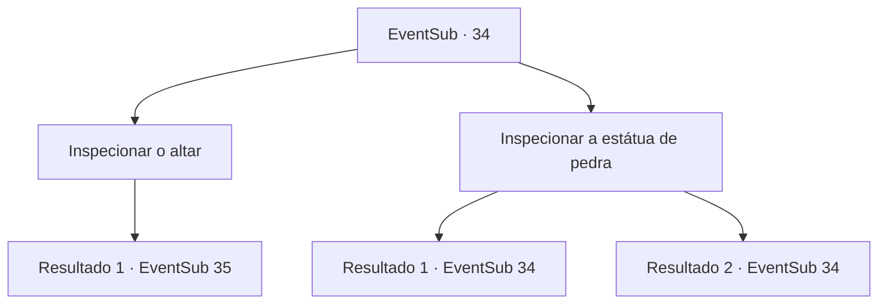

# Eventos secundários · 34

[Índice da tabela](index.md) · [Índice geral](../index.md)

ID: `pt:EventSub:34` · Fonte: `EventSub4` · Versão: 1.2.47.

Mapeamento estático dos arquivos; a disponibilidade e a execução dependem do estado da run.

## Texto do evento

*Sem texto no arquivo.*

## Dados de entrada

```json
{
  "id": 34,
  "grade": 1,
  "subEvent": "1",
  "required": ""
}
```

## Mapa das escolhas



## Escolhas e resultados

### Escolha 1

Inspecionar o altar

Requisitos e outros campos da escolha:

```json
{
  "required": ""
}
```

#### Resultado 1.1

Você verifica atentamente o altar. A poeira no altar foi esfregada como se alguém estivesse aqui recentemente. E nele um pequeno colar foi colocado. Você pega o colar e volta para o padre. 

 Depois de alguns dias viajando, você encontra o padre de novo. Ele ainda está orando.

Continuação registrada: [Evento 35](0035.md) na mesma tabela.

```json
{
  "required": "",
  "chance": "1",
  "nextEvent": 35,
  "type": 2,
  "reward": "3_72_1"
}
```

### Escolha 2

Inspecionar a estátua de pedra

Requisitos e outros campos da escolha:

```json
{
  "required": "5_36_0"
}
```

#### Resultado 2.1

Você verifica atentamente a estátua de pedra. A estátua de pedra não parece ter nada de especial.

Continuação registrada: [Evento 34](0034.md) na mesma tabela.

```json
{
  "required": "",
  "chance": "12",
  "nextEvent": 34,
  "type": 1,
  "reward": "5_36_1"
}
```

#### Resultado 2.2

Você verifica atentamente a estátua de pedra. Então você percebe que é um golem que estava anteriormente ativo. Mas agora o golem está inativo, pois sua magia foi esgotada. Você retira o núcleo mágico do golem.

Continuação registrada: [Evento 34](0034.md) na mesma tabela.

```json
{
  "required": "",
  "chance": "1|0_7_1",
  "nextEvent": 34,
  "type": 0,
  "reward": "5_36_1|3_101_1"
}
```

## Referências que chegam a este evento

- [Evento 33 · escolha 1 · resultado 1](0033.md#escolha-1)
- [Evento 33 · escolha 1 · resultado 2](0033.md#escolha-1)
- [Evento 33 · escolha 2 · resultado 1](0033.md#escolha-2)
- [Evento 33 · escolha 3 · resultado 1](0033.md#escolha-3)
- [Evento 34 · escolha 2 · resultado 1](0034.md#escolha-2)
- [Evento 34 · escolha 2 · resultado 2](0034.md#escolha-2)
