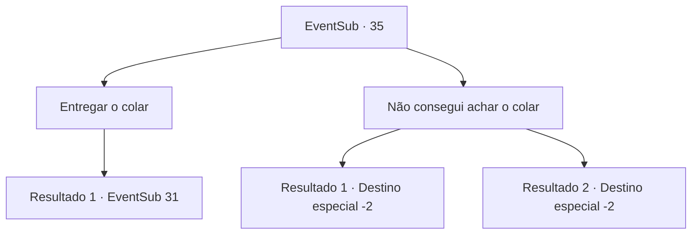

# Eventos secundários · 35

[Índice da tabela](index.md) · [Índice geral](../index.md)

ID: `pt:EventSub:35` · Fonte: `EventSub4` · Versão: 1.2.47.

Mapeamento estático dos arquivos; a disponibilidade e a execução dependem do estado da run.

## Texto do evento

*Sem texto no arquivo.*

## Dados de entrada

```json
{
  "id": 35,
  "grade": 1,
  "subEvent": "1",
  "required": ""
}
```

## Mapa das escolhas



## Escolhas e resultados

### Escolha 1

Entregar o colar

Requisitos e outros campos da escolha:

```json
{
  "required": ""
}
```

#### Resultado 1.1

Você entrega o colar. O padre está muito feliz e está disposto a ajudá -lo. 

 Você volta para a mansão do velho com o padre. O velho o cumprimenta calorosamente. O padre examina o jardim e começa a cavar em um canto. Então ele pega um capacete enferrujado. 

 "Este é o meio que liga o espectro a este lugar."

 Ele puxa uma garrafa de vidro da bolsa. Então ele derrama o líquido no capacete e o incendeia. O capacete é engolido em chamas verdes, e o padre começa a orar em frente ao fogo. 

 A partir daquela noite, os espectros nunca mais aparecem no jardim. O velho está bastante alegre e pergunta que tipo de recompensa você deseja.

Continuação registrada: [Evento 31](0031.md) na mesma tabela.

```json
{
  "required": "",
  "chance": "1",
  "nextEvent": 31,
  "type": 2,
  "reward": "4_72_1|12_1_-1|14_1_0"
}
```

### Escolha 2

Não consegui achar o colar

Requisitos e outros campos da escolha:

```json
{
  "required": ""
}
```

#### Resultado 2.1

Você fica com o colar do padre para si mesmo. Então você diz ao padre que não pôde encontrar o colar. Então o padre pede que você sai para que ele possa orar. 

 Agora você tem que ir á imobiliária para completar a missão do velho.

Continuação registrada: [Destino especial `-2`](../destinos-especiais.md).

```json
{
  "required": "18_37_2",
  "chance": "1",
  "nextEvent": -2,
  "type": 2,
  "reward": "12_1_3|5_35_2"
}
```

#### Resultado 2.2

Você fica com o colar do padre para si mesmo. Então você diz ao padre que não pôde encontrar o colar. Então o padre pede que você sai para que ele possa orar. No entanto, agora você não tem nenhum modo de completar a missão do velho.

Continuação registrada: [Destino especial `-2`](../destinos-especiais.md).

```json
{
  "required": "5_37_2",
  "chance": "1",
  "nextEvent": -2,
  "type": 2,
  "reward": "12_1_-1"
}
```

## Referências que chegam a este evento

- [Evento 34 · escolha 1 · resultado 1](0034.md#escolha-1)
