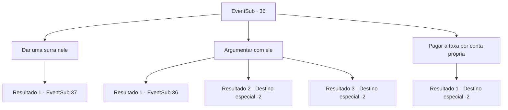

# Eventos secundários · 36

[Índice da tabela](index.md) · [Índice geral](../index.md)

ID: `pt:EventSub:36` · Fonte: `EventSub4` · Versão: 1.2.47.

Mapeamento estático dos arquivos; a disponibilidade e a execução dependem do estado da run.

## Texto do evento

*Sem texto no arquivo.*

## Dados de entrada

```json
{
  "id": 36,
  "grade": 1,
  "subEvent": "1",
  "required": "12_1_3"
}
```

## Mapa das escolhas



## Escolhas e resultados

### Escolha 1

Dar uma surra nele

Requisitos e outros campos da escolha:

```json
{
  "required": ""
}
```

#### Resultado 1.1

Você vira a mesa na sua frente e agarra a gola dele. O corretor grita surpreso. 

 "Gu... GUARDA!!"

 Alguns homens grandes se aproximam e vêm em sua direção.

Continuação registrada: [Evento 37](0037.md) na mesma tabela.

```json
{
  "required": "",
  "chance": "1",
  "nextEvent": 37,
  "type": 2,
  "reward": "6_0_91",
  "place": 10
}
```

### Escolha 2

Argumentar com ele

Requisitos e outros campos da escolha:

```json
{
  "required": "5_37_0"
}
```

#### Resultado 2.1

Você tenta convencer o agente imobiliário, mas ele nem sequer lhe dá ouvidos. Não parece que ele possa ser convencido.

Continuação registrada: [Evento 36](0036.md) na mesma tabela.

```json
{
  "required": "",
  "chance": "12",
  "nextEvent": 36,
  "type": 1,
  "reward": "5_37_1"
}
```

#### Resultado 2.2

Você convence com sucesso o agente imobiliário. 
 Como você solicitou, ele cancela o acordo que tem com Martin. Você leva o contrato a Martin com a impressão digital do agente para confirmar sua validade. 

 Martin está muito feliz e lhe dá uma recompensa. Você pega a pilha pesada de ouro e segue em outra aventura.

Continuação registrada: [Destino especial `-2`](../destinos-especiais.md).

```json
{
  "required": "",
  "chance": "1|0_7_1",
  "nextEvent": -2,
  "type": 0,
  "reward": "0_2_3|0_4_200|12_1_-1|14_1_2"
}
```

#### Resultado 2.3

Você convence com sucesso o agente imobiliário. 
 Como você solicitou, ele cancela o acordo que tem com Martin. Você leva o contrato a Martin com a impressão digital do agente para confirmar sua validade. 

 Martin está muito feliz e lhe dá uma recompensa. Você pega a pilha pesada de ouro e segue em outra aventura.

Continuação registrada: [Destino especial `-2`](../destinos-especiais.md).

```json
{
  "required": "5_35_2",
  "chance": "1|0_7_2",
  "nextEvent": -2,
  "type": 0,
  "reward": "0_2_3|0_4_200|12_1_-1|14_1_2"
}
```

### Escolha 3

Pagar a taxa por conta própria

Requisitos e outros campos da escolha:

```json
{
  "required": "1_4_1000"
}
```

#### Resultado 3.1

Em vez de invalidar o acordo, você decide pagar a penalidade. O agente imobiliário lhe entrega um contrato. 

 "Coloque sua impressão digital lá."

 Você faz o que ele pergunta e entrega a multa. Você leva o contrato a Martin com a impressão digital do agente para confirmar sua validade. 

 Martin está surpreso que você tenha pago a multa de multa por ele. Ele parece confuso e ordena que seu servo traga armadura e um baú. 

 "Esta armadura já foi usada pelo meu avô. Vou pagar minha dívida com você com isso. Espero que isso ajude você em sua jornada."

 Você vê que a armadura foi bem mantida ao longo dos anos. Você pega a armadura e o baú do dinheiro e depois sai em outra aventura.

Continuação registrada: [Destino especial `-2`](../destinos-especiais.md).

```json
{
  "required": "",
  "chance": "1",
  "nextEvent": -2,
  "type": 2,
  "reward": "0_2_4|3_107_1|0_4_-1000|12_1_-1|14_1_2"
}
```

## Referências que chegam a este evento

- [Evento 27 · escolha 2 · resultado 1](0027.md#escolha-2)
- [Evento 36 · escolha 2 · resultado 1](0036.md#escolha-2)
