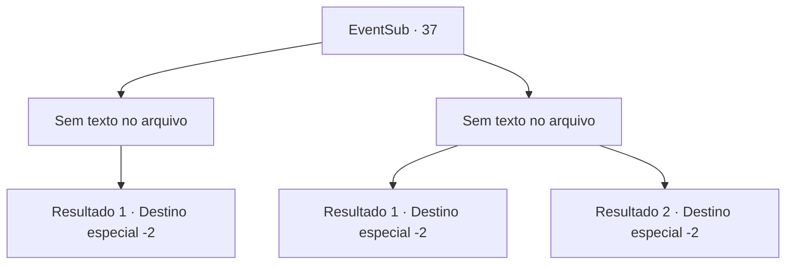

# Eventos secundários · 37

[Índice da tabela](index.md) · [Índice geral](../index.md)

ID: `pt:EventSub:37` · Fonte: `EventSub4` · Versão: 1.2.47.

Mapeamento estático dos arquivos; a disponibilidade e a execução dependem do estado da run.

## Texto do evento

*Sem texto no arquivo.*

## Dados de entrada

```json
{
  "id": 37,
  "grade": 1,
  "subEvent": "1",
  "required": ""
}
```

## Mapa das escolhas



## Escolhas e resultados

### Escolha 1

*Sem texto no arquivo; o papel dessa opção depende da interface do jogo.*

Requisitos e outros campos da escolha:

```json
{
  "required": ""
}
```

#### Resultado 1.1

Os Tholes e os guarda -costas não são páreo para você. Eles estão gemendo no chão, então Tholes diz. 

 "Por favor .... Poupe nossas vidas ...!"

 Como você solicitou, ele cancela o acordo que tem com Martin. Você leva o contrato a Martin, com a impressão digital do agente para confirmar sua validade. 

 Martin está muito feliz e lhe dá uma recompensa. Você pega a pilha pesada de ouro e segue em outra aventura.

Continuação registrada: [Destino especial `-2`](../destinos-especiais.md).

```json
{
  "required": "",
  "chance": "1",
  "nextEvent": -2,
  "type": 2,
  "reward": "0_2_3|0_4_200|12_1_-1|14_1_4"
}
```

### Escolha 2

*Sem texto no arquivo; o papel dessa opção depende da interface do jogo.*

Requisitos e outros campos da escolha:

```json
{
  "required": ""
}
```

#### Resultado 2.1

Você é dominado e expulso pelos seguranças. Você não poderá mais ver o agente imobiliário. Para completar a missão, você vai ver o padre.

Continuação registrada: [Destino especial `-2`](../destinos-especiais.md).

```json
{
  "required": "5_35_0",
  "chance": "1",
  "nextEvent": -2,
  "type": 2,
  "reward": "12_1_2|5_37_2"
}
```

#### Resultado 2.2

Você é dominado e expulso pelos seguranças. Você não poderá mais ver o agente imobiliário. Não é mais possível completar a missão do velho.

Continuação registrada: [Destino especial `-2`](../destinos-especiais.md).

```json
{
  "required": "5_35_2",
  "chance": "1",
  "nextEvent": -2,
  "type": 2,
  "reward": "12_1_-1|14_1_3"
}
```

## Referências que chegam a este evento

- [Evento 36 · escolha 1 · resultado 1](0036.md#escolha-1)
