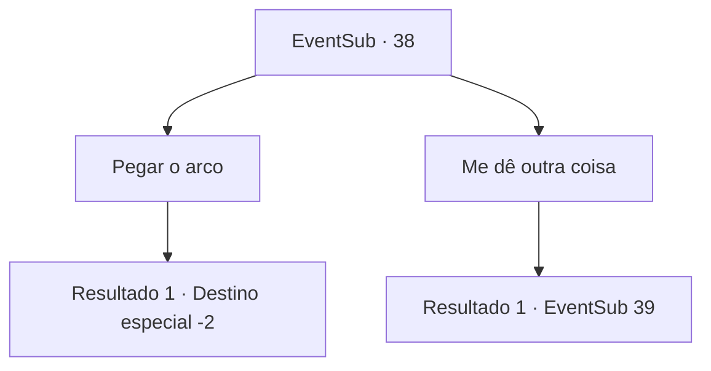

# Eventos secundários · 38

[Índice da tabela](index.md) · [Índice geral](../index.md)

ID: `pt:EventSub:38` · Fonte: `EventSub4` · Versão: 1.2.47.

Mapeamento estático dos arquivos; a disponibilidade e a execução dependem do estado da run.

## Texto do evento

Você entrou em um bar para descansar. Enquanto você está bebendo uma cerveja gelada, alguém se senta ao seu lado. É Majet, a mulher que esteve envolvida com a missão da Mulher Aranha. 

 "Eu finalmente encontrei você. Faz algum tempo."

 Ela o cumprimenta enquanto pede outra cerveja. Ela então instantaneamente bebe a cerveja e fala. 

 "Comprei um novo lugar. Então eu queria compensá-lo. Você se lembra do que eu disse antes?"

 Você pensa na primeira vez que a conheceu. Você se lembra claramente que ela prometeu retribuir, mesmo com a vida dela. Você acena com a cabeça e vai para a casa dela. 

 "Antes de conhecê-lo, encomendei um arco e o recebi recentemente. Será bastante útil."


## Dados de entrada

```json
{
  "id": 38,
  "grade": 1,
  "subEvent": "1",
  "required": "5_17_2"
}
```

## Mapa das escolhas



## Escolhas e resultados

### Escolha 1

Pegar o arco

Requisitos e outros campos da escolha:

```json
{
  "required": ""
}
```

#### Resultado 1.1

Você toma o arco que ela presenteia. 
 Ela fala de uma maneira descontraída. 

 "Então minha dívida está paga, não é? Venha visitar a qualquer hora."

 Você se despede e sai pra outra aventura.

Continuação registrada: [Destino especial `-2`](../destinos-especiais.md).

```json
{
  "required": "",
  "chance": "1",
  "nextEvent": -2,
  "type": 2,
  "reward": "3_81_1|0_2_2|5_17_3"
}
```

### Escolha 2

Me dê outra coisa

Requisitos e outros campos da escolha:

```json
{
  "required": ""
}
```

#### Resultado 2.1

Você diz a ela para lhe dar algo diferente do arco. 
 Ela pensa por um segundo e depois pergunta o que você deseja.

Continuação registrada: [Evento 39](0039.md) na mesma tabela.

```json
{
  "required": "",
  "chance": "12",
  "nextEvent": 39,
  "type": 2,
  "reward": ""
}
```

## Referências que chegam a este evento

Nenhum `nextEvent` positivo da mesma tabela aponta para este nó. Isso não prova que seja inacessível: sorteio e estado de história podem selecioná-lo.

