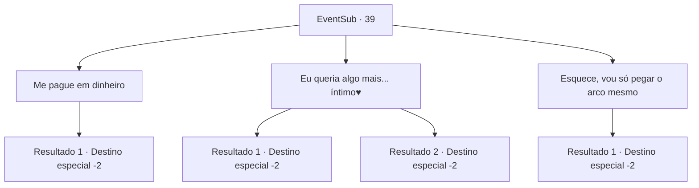

# Eventos secundários · 39

[Índice da tabela](index.md) · [Índice geral](../index.md)

ID: `pt:EventSub:39` · Fonte: `EventSub4` · Versão: 1.2.47.

Mapeamento estático dos arquivos; a disponibilidade e a execução dependem do estado da run.

## Texto do evento

*Sem texto no arquivo.*

## Dados de entrada

```json
{
  "id": 39,
  "grade": 1,
  "subEvent": "1",
  "required": ""
}
```

## Mapa das escolhas



## Escolhas e resultados

### Escolha 1

Me pague em dinheiro

Requisitos e outros campos da escolha:

```json
{
  "required": ""
}
```

#### Resultado 1.1

Você pede para ela para mostrar a gratidão com dinheiro, e não o arco. 
 Ela entra em sua casa por um segundo e depois sai com um pequeno pacote. 

 "Aqui. Pegue isso. Então estamos quites agora?"

 Você aceita feliz a pequena sacola de ouro. Você se despeda e parte em outra aventura.

Continuação registrada: [Destino especial `-2`](../destinos-especiais.md).

```json
{
  "required": "",
  "chance": "1",
  "nextEvent": -2,
  "type": 2,
  "reward": "0_4_350|0_2_2|5_17_3"
}
```

### Escolha 2

Eu queria algo mais... íntimo♥

Requisitos e outros campos da escolha:

```json
{
  "required": "24_1_1"
}
```

#### Resultado 2.1

Você decide paquerá-la. 
 Ela lhe entrega o arco com um olhar enojado. 

 "Deixe de brincadeira... agora vá embora."

 Então ela fecha a porta. Você pega o arco e sai para outra aventura, de mal humor.

Continuação registrada: [Destino especial `-2`](../destinos-especiais.md).

```json
{
  "required": "",
  "chance": "12",
  "nextEvent": -2,
  "type": 1,
  "reward": "3_81_1|0_2_2|5_17_3"
}
```

#### Resultado 2.2

Você decide paquerá-la. Ela cora um pouco e começa a rir. Ela toma sua mão e lhe puxa para si. <link=wave> 

 "É melhor você se preparar."

 </link> Ela lhe puxa para dentro de casa. Depois de passar um tempo suado juntos, vocês se despedem. Você se torna amante dela.

Continuação registrada: [Destino especial `-2`](../destinos-especiais.md).

```json
{
  "required": "",
  "chance": "1|0_12_1",
  "nextEvent": -2,
  "type": 0,
  "reward": "0_0_1|0_1_2|0_2_2|0_6_2|5_17_4"
}
```

### Escolha 3

Esquece, vou só pegar o arco mesmo

Requisitos e outros campos da escolha:

```json
{
  "required": ""
}
```

#### Resultado 3.1

Você toma o arco que ela presenteia. 
 Ela fala de uma maneira descontraída. 

 "Então minha dívida está paga, não é? Venha visitar a qualquer hora."

 Você se despede e sai pra outra aventura.

Continuação registrada: [Destino especial `-2`](../destinos-especiais.md).

```json
{
  "required": "",
  "chance": "1",
  "nextEvent": -2,
  "type": 2,
  "reward": "3_81_1|0_2_2|5_17_3"
}
```

## Referências que chegam a este evento

- [Evento 38 · escolha 2 · resultado 1](0038.md#escolha-2)
