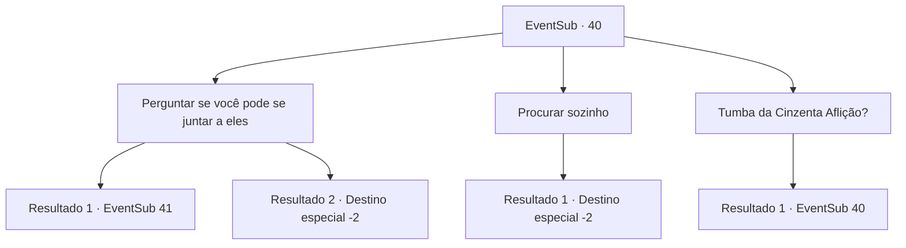

# Eventos secundários · 40

[Índice da tabela](index.md) · [Índice geral](../index.md)

ID: `pt:EventSub:40` · Fonte: `EventSub4` · Versão: 1.2.47.

Mapeamento estático dos arquivos; a disponibilidade e a execução dependem do estado da run.

## Texto do evento

Você ouve três andarilhos conversando. Eles falam de uma 'Tumba da Cinzenta Aflição' onde o rei de um reino caído está enterrado. Eles planejam fazer uma visita.

## Dados de entrada

```json
{
  "id": 40,
  "grade": 1,
  "subEvent": "2",
  "required": "12_2_0"
}
```

## Mapa das escolhas



## Escolhas e resultados

### Escolha 1

Perguntar se você pode se  juntar a eles

Requisitos e outros campos da escolha:

```json
{
  "required": ""
}
```

#### Resultado 1.1

Você cumprimenta os viajantes e pergunta se pode se juntar a eles. Eles te olham com desconfiança. 

 "Mas nós não sabemos quem você é. Por que deveríamos deixar você vir?"


Continuação registrada: [Evento 41](0041.md) na mesma tabela.

```json
{
  "required": "2_2_50",
  "chance": "1",
  "nextEvent": 41,
  "type": 2,
  "reward": ""
}
```

#### Resultado 1.2

Você cumprimenta os viajantes e pergunta se pode se juntar a eles. Um homem bem vestido dá um passo à frente e te cumprimenta de volta. 

 "Prazer em conhecê-lo. Você é {1}, certo? Meu nome é Enard. Um aventureiro como você é sempre bem-vindo na equipe. Dizem que essa Tumba do Lamento Ardente é terrivelmente perigosa."

 Ele apresenta os outros dois viajantes. O anão de barba grande se chama Volga, e o homem musculoso ao lado dele é Nisil. Eles partem, prometendo se reunir com você após se prepararem para a jornada.

Continuação registrada: [Destino especial `-2`](../destinos-especiais.md).

```json
{
  "required": "1_2_50",
  "chance": "1",
  "nextEvent": -2,
  "type": 2,
  "reward": "12_2_2"
}
```

### Escolha 2

Procurar sozinho

Requisitos e outros campos da escolha:

```json
{
  "required": ""
}
```

#### Resultado 2.1

Eles estão animadamente falando sobre o quanto de tesouro um túmulo real deve ter. Você escuta a conversa deles e decide ir procurar o Túmulo do Lamento Ardente por si mesmo. Você deixa os viajantes para trás enquanto eles discutem como dividir o saque.

Continuação registrada: [Destino especial `-2`](../destinos-especiais.md).

```json
{
  "required": "",
  "chance": "1",
  "nextEvent": -2,
  "type": 2,
  "reward": "12_2_3"
}
```

### Escolha 3

Tumba da Cinzenta Aflição?

Requisitos e outros campos da escolha:

```json
{
  "required": "5_50_0"
}
```

#### Resultado 3.1

O anão barbudo responde à sua pergunta. 

 "Oh, dizem que recebeu esse nome porque as vinhas escuras que crescem perto do túmulo choram para lamentar o reino caído."


Continuação registrada: [Evento 40](0040.md) na mesma tabela.

```json
{
  "required": "",
  "chance": "1",
  "nextEvent": 40,
  "type": 2,
  "reward": "5_50_1"
}
```

## Referências que chegam a este evento

- [Evento 40 · escolha 3 · resultado 1](0040.md#escolha-3)
