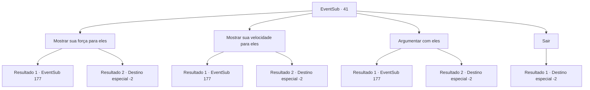

# Eventos secundários · 41

[Índice da tabela](index.md) · [Índice geral](../index.md)

ID: `pt:EventSub:41` · Fonte: `EventSub4` · Versão: 1.2.47.

Mapeamento estático dos arquivos; a disponibilidade e a execução dependem do estado da run.

## Texto do evento

*Sem texto no arquivo.*

## Dados de entrada

```json
{
  "id": 41,
  "grade": 1,
  "subEvent": "2",
  "required": ""
}
```

## Mapa das escolhas



## Escolhas e resultados

### Escolha 1

Mostrar sua força para eles

Requisitos e outros campos da escolha:

```json
{
  "required": ""
}
```

#### Resultado 1.1

Você propõe o arbusto de braço o anão. Ele ri e agarra você pelo braço. 
3 ... 2 ... 1 
 O anão vira seu braço para o outro lado assim que a contagem regressiva termina. Ele tira as mãos e sorri de orgulho. 

 "Vá buscar mais vegetais verdes, garoto!"

 Os Wanderers saem sem você.

Continuação registrada: [Evento 177](0177.md) na mesma tabela.

```json
{
  "required": "",
  "chance": "12",
  "nextEvent": 177,
  "type": 1,
  "reward": "12_2_-1"
}
```

#### Resultado 1.2

Você propõe o arbusto de braço o anão. Ele ri e agarra você pelo braço. 
3 ... 2 ... 1 
 Você vira o braço do anão para o outro lado assim que a contagem regressiva termina. Ele não pode acreditar. Um dos outros Wanderers o cumprimenta. 

 "Certamente poderíamos usar sua força. O nome é ENARD. Um aventureiro como você é sempre bem -vindo na equipe. Diz -se que esta tumba de luto é terrivelmente perigosa."

 Ele apresenta os outros dois andarilhos. O anão com a barba grande é chamado Volga, e o homem musculoso ao lado dele é Nisil. Eles saem, prometendo se reagrupar com você depois de se preparar para a jornada.

Continuação registrada: [Destino especial `-2`](../destinos-especiais.md).

```json
{
  "required": "",
  "chance": "1|0_5_1",
  "nextEvent": -2,
  "type": 0,
  "reward": "12_2_2"
}
```

### Escolha 2

Mostrar sua velocidade para eles

Requisitos e outros campos da escolha:

```json
{
  "required": ""
}
```

#### Resultado 2.1

Você pede a eles para te atingirem para demonstrar sua velocidade. O mais musculoso do grupo se coloca na sua frente. Seu punho voa em sua direção sem aviso. Você não é rápido o suficiente para reagir. Seu nariz arde enquanto você o segura. O homem recua o braço e fala. 

 "Você tem muito a aprender."

 Os viajantes partem sem você.

Continuação registrada: [Evento 177](0177.md) na mesma tabela.

```json
{
  "required": "",
  "chance": "12",
  "nextEvent": 177,
  "type": 1,
  "reward": "12_2_-1"
}
```

#### Resultado 2.2

Você pede a eles para te atingirem para demonstrar sua velocidade. O mais musculoso do grupo se coloca na sua frente. Seu punho vem voando em sua direção sem aviso. Você desvia e acerta um golpe de contra-ataque em seu corpo. O homem segura o estômago e recua. Um dos outros viajantes te cumprimenta. 

 "Nós certamente poderíamos usar sua força. Me chamo Enard. Um aventureiro como você é sempre bem-vindo na equipe. Dizem que essa Tumba do Luto Ardente é terrivelmente perigosa."

 Ele apresenta os outros dois viajantes. O anão de barba grande se chama Volga, e o homem musculoso é Nisil. Eles partem, prometendo se reunir com você após se prepararem para a jornada.

Continuação registrada: [Destino especial `-2`](../destinos-especiais.md).

```json
{
  "required": "",
  "chance": "1|0_6_1",
  "nextEvent": -2,
  "type": 0,
  "reward": "12_2_2"
}
```

### Escolha 3

Argumentar com eles

Requisitos e outros campos da escolha:

```json
{
  "required": "1_7_9"
}
```

#### Resultado 3.1

Tentas persuadi-los, mas eles não ouvem. O mais afiado do grupo abre a boca. 

 "Não entendo o que estás a tentar dizer. Da próxima vez, tenta pensar antes de falar."

 Os viajantes partem sem ti.

Continuação registrada: [Evento 177](0177.md) na mesma tabela.

```json
{
  "required": "",
  "chance": "12",
  "nextEvent": 177,
  "type": 1,
  "reward": "12_2_-1"
}
```

#### Resultado 3.2

Você os persuade com sucesso. O mais bem vestido do grupo acena com a cabeça. 

 "Ótimo. Certamente poderíamos usar sua língua e intelecto. Você pode se juntar a nós."

 Ele apresenta os outros dois viajantes. O anão com a barba grande se chama Volga, e o homem musculoso é Nisil. Eles partem, prometendo se reunir com você depois de se prepararem para a jornada.

Continuação registrada: [Destino especial `-2`](../destinos-especiais.md).

```json
{
  "required": "",
  "chance": "1|0_7_1",
  "nextEvent": -2,
  "type": 0,
  "reward": "12_2_2"
}
```

### Escolha 4

Sair

Requisitos e outros campos da escolha:

```json
{
  "required": ""
}
```

#### Resultado 4.1

Você desiste e se afasta deles.

Continuação registrada: [Destino especial `-2`](../destinos-especiais.md).

```json
{
  "required": "",
  "chance": "1",
  "nextEvent": -2,
  "type": 2,
  "reward": "12_2_-1"
}
```

## Referências que chegam a este evento

- [Evento 40 · escolha 1 · resultado 1](0040.md#escolha-1)
