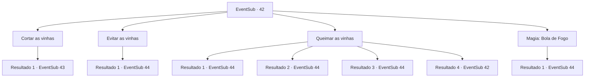

# Eventos secundários · 42

[Índice da tabela](index.md) · [Índice geral](../index.md)

ID: `pt:EventSub:42` · Fonte: `EventSub4` · Versão: 1.2.47.

Mapeamento estático dos arquivos; a disponibilidade e a execução dependem do estado da run.

## Texto do evento

Você se reagrupa com os andarilhos e segue para a Tumba da Cinzenta Aflição. Alguns dias depois, você chega à sua entrada. |drawing_sadGrave| Está coberto de trepadeiras escuras e pegajosas. De acordo com Enard, o tesouro está escondido em uma câmara de pedra no centro da tumba. Nisil murmura baixinho. 

 "Essas vinhas me incomodam. Parece que elas estão nos observando."

 Volga ri e balança seu machado em uma das videiras. 

 "Besteira, elas podem ser cortadas igual gra-AHHH!"

 As videiras o envolvem e o tiram do chão antes que ele possa terminar.

## Dados de entrada

```json
{
  "id": 42,
  "grade": 1,
  "subEvent": "2",
  "required": "12_2_2"
}
```

## Mapa das escolhas



## Escolhas e resultados

### Escolha 1

Cortar as vinhas

Requisitos e outros campos da escolha:

```json
{
  "required": ""
}
```

#### Resultado 1.1

Você começa a cortar as vinhas escuras. Elas se contorcem de dor enquanto líquido vermelho espirra de suas feridas. Em seguida, elas rapidamente se enrolam ao seu redor.

Continuação registrada: [Evento 43](0043.md) na mesma tabela.

```json
{
  "required": "",
  "chance": "1",
  "nextEvent": 43,
  "type": 2,
  "reward": "6_0_64",
  "place": 1
}
```

### Escolha 2

Evitar as vinhas

Requisitos e outros campos da escolha:

```json
{
  "required": ""
}
```

#### Resultado 2.1

Como as videiras arrastam o volga para a escuridão, 
 Você e os outros dois Wanderers vão para a câmara de pedra no centro. ENARD recupere a respiração. 

 "Bem ... pelo menos chegamos aqui vivos."

 Nenhum deles parecia estar preocupado com o anão. 
 ENARD acende sua lanterna para inspecionar a câmara. As teias de aranha empoeiradas cobrem as paredes, estão gravadas com padrões geométricos místicos. Vocês três viajam cuidadosamente para dentro. 
 Logo você chega a uma pequena porta de pedra. 

 "Algo está do outro lado."

 Nisil diz nervosamente.

Continuação registrada: [Evento 44](0044.md) na mesma tabela.

```json
{
  "required": "",
  "chance": "1",
  "nextEvent": 44,
  "type": 2,
  "reward": ""
}
```

### Escolha 3

Queimar as vinhas

Requisitos e outros campos da escolha:

```json
{
  "required": "5_57_0"
}
```

#### Resultado 3.1

Você acende uma combinação e o joga nas videiras. Eles instantaneamente se inflamam e começam a queimar intensamente. O problema é que o Volga queima com eles. 

 "Ahhhhhh !! NOOOOOOOO !!!"

 Ele se contorce de dor antes de queimar até um pouco. O incêndio morre depois de queimar todas as últimas vertentes das videiras. 

 Os Wanderers silenciosamente seguem em direção à câmara de pedra. ENARD acende sua lanterna para inspecioná -la. As teias de aranha empoeiradas cobrem as paredes, gravadas com padrões geométricos místicos. Vocês três viajam cuidadosamente para dentro. Logo você chega a uma pequena porta de pedra. 

 "Algo está do outro lado."

 Nisil diz nervosamente.

Continuação registrada: [Evento 44](0044.md) na mesma tabela.

```json
{
  "required": "8_40_1",
  "chance": "1",
  "nextEvent": 44,
  "type": 2,
  "reward": "0_3_-3|4_40_1"
}
```

#### Resultado 3.2

Você acende uma combinação e joga -o nas videiras. 
 Eles instantaneamente se inflamam e começam a queimar intensamente. 
 O problema é que o Volga queima com eles. 
 

 "Ahhhhhh !! NOOOOOOOO !!!"

 Ele se contorce de dor antes de queimar até um pouco. O incêndio morre depois de queimar todas as últimas vertentes das videiras. 

 Os Wanderers silenciosamente seguem em direção à câmara de pedra. ENARD acende sua lanterna para inspecioná -la. As teias de aranha empoeiradas cobrem as paredes, gravadas com padrões geométricos místicos. Vocês três viajam cuidadosamente para dentro. Logo você chega a uma pequena porta de pedra. 

 "Algo está do outro lado."

 Nisil diz nervosamente.

Continuação registrada: [Evento 44](0044.md) na mesma tabela.

```json
{
  "required": "8_47_1",
  "chance": "1",
  "nextEvent": 44,
  "type": 2,
  "reward": "4_47_1"
}
```

#### Resultado 3.3

Você acende uma combinação e joga -o nas videiras. 
 Eles instantaneamente se inflamam e começam a queimar intensamente. 
 O problema é que o Volga queima com eles. 

 "Ahhhhhh !! NOOOOOOOO !!!"

 Ele se contorce de dor antes de queimar até um pouco. O fogo cresce fora de controle, e o resto de vocês não tem escolha a não ser vê -lo morrer. As chamas morrem depois de queimar todas as últimas vertentes da videira. 

 Os Wanderers silenciosamente seguem em direção à câmara de pedra. ENARD acende sua lanterna para inspecioná -la. As teias de aranha empoeiradas cobrem as paredes, gravadas com padrões geométricos místicos. Vocês três viajam cuidadosamente para dentro. Logo você chega a uma pequena porta de pedra. 

 "Algo está do outro lado."

 Nisil diz nervosamente.

Continuação registrada: [Evento 44](0044.md) na mesma tabela.

```json
{
  "required": "8_42_1",
  "chance": "1",
  "nextEvent": 44,
  "type": 2,
  "reward": "4_42_1"
}
```

#### Resultado 3.4

Tentas queimar as videiras, mas percebes que não tens nada para começar um incêndio. Precisas de uma ideia melhor.

Continuação registrada: [Evento 42](0042.md) na mesma tabela.

```json
{
  "required": "10_42_1|10_47_1|10_40_1",
  "chance": "1",
  "nextEvent": 42,
  "type": 2,
  "reward": "5_57_1"
}
```

### Escolha 4

Magia: Bola de Fogo

Requisitos e outros campos da escolha:

```json
{
  "required": "20_0_2|1_1_2"
}
```

#### Resultado 4.1

Você consegue se concentrar e formar uma bola de fogo. Você arremedia nas videiras. 
 Eles instantaneamente se inflamam e começam a queimar intensamente. 
 O problema é que o Volga queima com eles. 

 "Ahhhhhh !! NOOOOOOOO !!!"

 Ele se contorce de dor antes de queimar até um pouco. O fogo cresce fora de controle, e o resto de vocês não tem escolha a não ser vê -lo morrer. As chamas morrem depois de queimar todas as últimas vertentes das videiras. 

 Os Wanderers silenciosamente seguem em direção à câmara de pedra. ENARD acende sua lanterna para inspecioná -la. As teias de aranha empoeiradas cobrem as paredes, gravadas com padrões geométricos místicos. Vocês três viajam cuidadosamente para dentro. Logo você chega a uma pequena porta de pedra. 

 "Algo está do outro lado."

 Nisil diz nervosamente.

Continuação registrada: [Evento 44](0044.md) na mesma tabela.

```json
{
  "required": "",
  "chance": "1",
  "nextEvent": 44,
  "type": 2,
  "reward": "0_3_-3|0_1_-1"
}
```

## Referências que chegam a este evento

- [Evento 42 · escolha 3 · resultado 4](0042.md#escolha-3)
