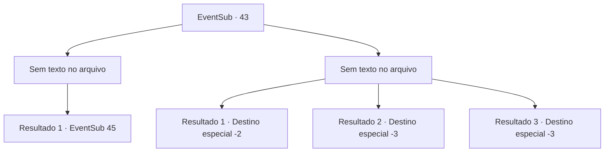

# Eventos secundários · 43

[Índice da tabela](index.md) · [Índice geral](../index.md)

ID: `pt:EventSub:43` · Fonte: `EventSub4` · Versão: 1.2.47.

Mapeamento estático dos arquivos; a disponibilidade e a execução dependem do estado da run.

## Texto do evento

*Sem texto no arquivo.*

## Dados de entrada

```json
{
  "id": 43,
  "grade": 1,
  "subEvent": "2",
  "required": ""
}
```

## Mapa das escolhas



## Escolhas e resultados

### Escolha 1

*Sem texto no arquivo; o papel dessa opção depende da interface do jogo.*

Requisitos e outros campos da escolha:

```json
{
  "required": ""
}
```

#### Resultado 1.1

As videiras voltam ao chão. Volga é coberto de cortes, mas ele está vivo e bem. Ele segura sua mão grossa em gratidão. 

 "Eu devo a você um, obrigado!"

 Você e os Wanderers descem para a câmara de pedra. ENARD acende sua lanterna para inspecioná -la. As teias de aranha empoeiradas cobrem as paredes, gravadas com padrões geométricos místicos. Vocês três viajam cuidadosamente para dentro. Logo você chega a uma pequena porta de pedra. 

 "Algo está do outro lado."

 Nisil diz nervosamente. De repente, Volga chuta a porta e marcha para dentro. |drawing_hangingBats| Milhares de morcegos descem do teto e voam em sua direção. Volga balança freneticamente seu machado no ar enquanto os roedores alados sedentos de sangue o cercam.

Continuação registrada: [Evento 45](0045.md) na mesma tabela.

```json
{
  "required": "",
  "chance": "1",
  "nextEvent": 45,
  "type": 2,
  "reward": ""
}
```

### Escolha 2

*Sem texto no arquivo; o papel dessa opção depende da interface do jogo.*

Requisitos e outros campos da escolha:

```json
{
  "required": ""
}
```

#### Resultado 2.1

Você luta contra as vinhas enquanto elas drenam todo o fluido corporal de Volga e o transformam em uma múmia. Enard e Nisil partem para a câmara de pedra sem você. Ferido, você não tem escolha a não ser recuar.

Continuação registrada: [Destino especial `-2`](../destinos-especiais.md).

```json
{
  "required": "1_0_2|1_1_2",
  "chance": "1",
  "nextEvent": -2,
  "type": 2,
  "reward": "0_0_-1|0_1_-1|12_2_-1|0_2_1"
}
```

#### Resultado 2.2

Você acaba compartilhando o destino de Volga. As videiras se enrolam em você e se alimentam do seu fluido corporal. Você se mumifica em pouco tempo.

Continuação registrada: [Destino especial `-3`](../destinos-especiais.md).

```json
{
  "required": "2_0_2",
  "chance": "1",
  "nextEvent": -3,
  "type": 2,
  "reward": "0_0_-1|0_1_-1"
}
```

#### Resultado 2.3

Você acaba compartilhando o destino de Volga. As videiras se enrolam em você e se alimentam do seu fluido corporal. Você se mumifica em pouco tempo.

Continuação registrada: [Destino especial `-3`](../destinos-especiais.md).

```json
{
  "required": "2_1_2",
  "chance": "1",
  "nextEvent": -3,
  "type": 2,
  "reward": "0_0_-1|0_1_-1"
}
```

## Referências que chegam a este evento

- [Evento 42 · escolha 1 · resultado 1](0042.md#escolha-1)
