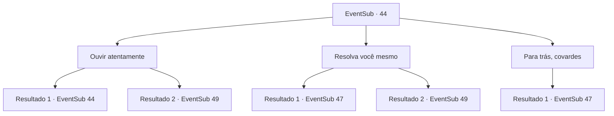

# Eventos secundários · 44

[Índice da tabela](index.md) · [Índice geral](../index.md)

ID: `pt:EventSub:44` · Fonte: `EventSub4` · Versão: 1.2.47.

Mapeamento estático dos arquivos; a disponibilidade e a execução dependem do estado da run.

## Texto do evento

*Sem texto no arquivo.*

## Dados de entrada

```json
{
  "id": 44,
  "grade": 1,
  "subEvent": "2",
  "required": ""
}
```

## Mapa das escolhas



## Escolhas e resultados

### Escolha 1

Ouvir atentamente

Requisitos e outros campos da escolha:

```json
{
  "required": "5_43_0"
}
```

#### Resultado 1.1

Você se concentra e tenta descobrir o que está acontecendo do outro lado da porta. Mas você não ouve nada.

Continuação registrada: [Evento 44](0044.md) na mesma tabela.

```json
{
  "required": "",
  "chance": "10",
  "nextEvent": 44,
  "type": 1,
  "reward": "5_43_1"
}
```

#### Resultado 1.2

Você se concentra e tenta descobrir o que está acontecendo do outro lado da porta. Você ouve roedores gritando e asas batendo ... Deve haver um enxame de morcegos do outro lado. |drawing_hangingBats| Vocês três rastejam de quatro e passam pelos morcegos. 

 Depois de passar por um corredor estreito, você se depara com uma porta de pedra gigante. A escrita sobre ele diz 'um pagará no sangue' e você notará um buraco perto do fundo grande o suficiente para se encaixar em uma pessoa.

Continuação registrada: [Evento 49](0049.md) na mesma tabela.

```json
{
  "required": "",
  "chance": "1|0_14_1",
  "nextEvent": 49,
  "type": 0,
  "reward": "5_43_2"
}
```

### Escolha 2

Resolva você mesmo

Requisitos e outros campos da escolha:

```json
{
  "required": "5_43_0"
}
```

#### Resultado 2.1

Nisil franze a testa e tenta ouvir. Ele coça a cabeça e admite que também não tem ideia. Você empurra a porta aberta e entra marchando. Milhares de morcegos mergulham do teto e voam em sua direção.

Continuação registrada: [Evento 47](0047.md) na mesma tabela.

```json
{
  "required": "",
  "chance": "1",
  "nextEvent": 47,
  "type": 2,
  "reward": "6_0_66",
  "place": 6
}
```

#### Resultado 2.2

Nisil franze a testa e ouve. Ele diz que deve haver um enxame de morcegos do outro lado. Com certeza, você abre a porta e encontra milhares de morcegos no teto. Vocês três rastejam de quatro e passam pelos morcegos. 

 Depois de passar por um corredor estreito, você se depara com uma porta de pedra gigante. A escrita sobre ele diz 'um pagará no sangue' e você notará um buraco perto do fundo grande o suficiente para se encaixar em uma pessoa.

Continuação registrada: [Evento 49](0049.md) na mesma tabela.

```json
{
  "required": "",
  "chance": "1",
  "nextEvent": 49,
  "type": 2,
  "reward": ""
}
```

### Escolha 3

Para trás, covardes

Requisitos e outros campos da escolha:

```json
{
  "required": ""
}
```

#### Resultado 3.1

Você chuta a porta. Milhares de morcegos mergulham do teto e voam em sua direção.

Continuação registrada: [Evento 47](0047.md) na mesma tabela.

```json
{
  "required": "",
  "chance": "1",
  "nextEvent": 47,
  "type": 2,
  "reward": "6_0_66",
  "place": 6
}
```

## Referências que chegam a este evento

- [Evento 42 · escolha 2 · resultado 1](0042.md#escolha-2)
- [Evento 42 · escolha 3 · resultado 1](0042.md#escolha-3)
- [Evento 42 · escolha 3 · resultado 2](0042.md#escolha-3)
- [Evento 42 · escolha 3 · resultado 3](0042.md#escolha-3)
- [Evento 42 · escolha 4 · resultado 1](0042.md#escolha-4)
- [Evento 44 · escolha 1 · resultado 1](0044.md#escolha-1)
