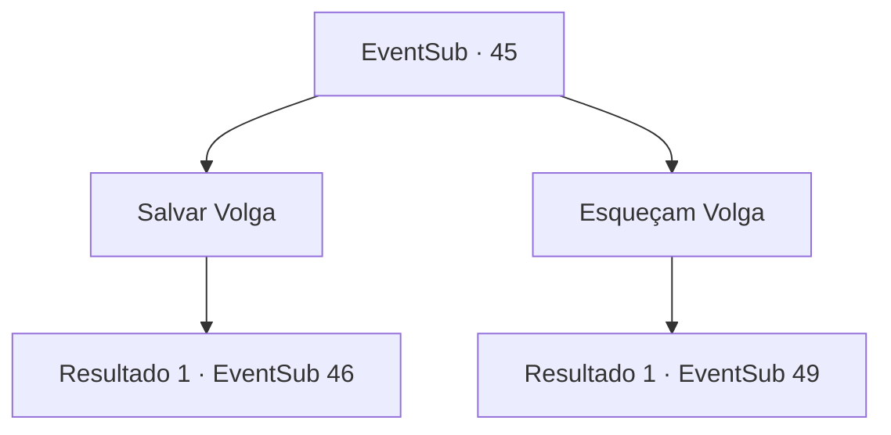

# Eventos secundários · 45

[Índice da tabela](index.md) · [Índice geral](../index.md)

ID: `pt:EventSub:45` · Fonte: `EventSub4` · Versão: 1.2.47.

Mapeamento estático dos arquivos; a disponibilidade e a execução dependem do estado da run.

## Texto do evento

*Sem texto no arquivo.*

## Dados de entrada

```json
{
  "id": 45,
  "grade": 1,
  "subEvent": "2",
  "required": ""
}
```

## Mapa das escolhas



## Escolhas e resultados

### Escolha 1

Salvar Volga

Requisitos e outros campos da escolha:

```json
{
  "required": ""
}
```

#### Resultado 1.1

Volga grita e balança seu machado no ar. Você decide que ele precisa de ajuda. Enquanto você puxa sua arma, Enard e Nisil relutantemente se juntam a você para lutar contra os morcegos.

Continuação registrada: [Evento 46](0046.md) na mesma tabela.

```json
{
  "required": "",
  "chance": "1",
  "nextEvent": 46,
  "type": 2,
  "reward": "6_2_66|0_3_1",
  "place": 6
}
```

### Escolha 2

Esqueçam Volga

Requisitos e outros campos da escolha:

```json
{
  "required": ""
}
```

#### Resultado 2.1

Volga é completamente cercado por morcegos. 
 Você e os outros dois aproveitam a oportunidade de passar por eles. Você corre por um corredor estreito até uma porta de pedra gigante. A escrita sobre ele diz 'um pagará no sangue' e você notará um buraco perto do fundo grande o suficiente para se encaixar em uma pessoa.

Continuação registrada: [Evento 49](0049.md) na mesma tabela.

```json
{
  "required": "",
  "chance": "1",
  "nextEvent": 49,
  "type": 2,
  "reward": "0_3_-3"
}
```

## Referências que chegam a este evento

- [Evento 43 · escolha 1 · resultado 1](0043.md#escolha-1)
