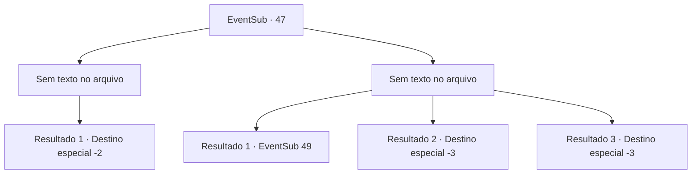

# Eventos secundários · 47

[Índice da tabela](index.md) · [Índice geral](../index.md)

ID: `pt:EventSub:47` · Fonte: `EventSub4` · Versão: 1.2.47.

Mapeamento estático dos arquivos; a disponibilidade e a execução dependem do estado da run.

## Texto do evento

*Sem texto no arquivo.*

## Dados de entrada

```json
{
  "id": 47,
  "grade": 1,
  "subEvent": "2",
  "required": ""
}
```

## Mapa das escolhas



## Escolhas e resultados

### Escolha 1

*Sem texto no arquivo; o papel dessa opção depende da interface do jogo.*

Requisitos e outros campos da escolha:

```json
{
  "required": ""
}
```

#### Resultado 1.1

Você está coberto de suor quando os morcegos voam para longe. O chão está cheio de morcegos mortos. Você olha em volta e percebe que ENARD e NISIL já fugiram. 

 Depois de passar por um corredor estreito, você se depara com uma porta de pedra gigante. A escrita sobre ele diz 'um pagará no sangue' e você notará um buraco perto do fundo grande o suficiente para se encaixar em uma pessoa. Você vê Nisil empurrando ENARD através dele. 

 "Você éshoooooooooooooooooooonte!"

 Gritando, ENARD é sugado. 
 . 
 .. 
 ... 
 A porta se abre algum tempo depois. |drawing_emptyCoffin| Apenas um caixão de obsidiano vazio permanece dentro. A porta de saída também está aberta, o que significa que ENARD deve ter reunido todo o tesouro e saiu. Você e Nisil retornam à superfície de mãos vazias.

Continuação registrada: [Destino especial `-2`](../destinos-especiais.md).

```json
{
  "required": "",
  "chance": "1",
  "nextEvent": -2,
  "type": 2,
  "reward": "0_3_-3|12_2_-1|14_2_0"
}
```

### Escolha 2

*Sem texto no arquivo; o papel dessa opção depende da interface do jogo.*

Requisitos e outros campos da escolha:

```json
{
  "required": ""
}
```

#### Resultado 2.1

Você, ENARD e NISIL conseguem passar por um corredor estreito, o tempo todo sendo mordido violentamente pelos roedores alados. 

 Depois de passar por um corredor estreito, você se depara com uma porta de pedra gigante. A escrita sobre ele diz 'um pagará no sangue' e você notará um buraco perto do fundo grande o suficiente para se encaixar em uma pessoa.

Continuação registrada: [Evento 49](0049.md) na mesma tabela.

```json
{
  "required": "1_0_2|1_1_2",
  "chance": "1",
  "nextEvent": 49,
  "type": 2,
  "reward": "0_0_-1|0_1_-1|0_2_1"
}
```

#### Resultado 2.2

Morcegos sedentos de sangue te cercam e começam a morder todas as partes do seu corpo. Eles sugam o seu sangue e você sente frio enquanto sua mente se desvanece.

Continuação registrada: [Destino especial `-3`](../destinos-especiais.md).

```json
{
  "required": "2_0_2",
  "chance": "1",
  "nextEvent": -3,
  "type": 2,
  "reward": "0_0_-1|0_1_-1"
}
```

#### Resultado 2.3

Morcegos sedentos de sangue te cercam e começam a morder todas as partes do seu corpo. Eles sugam o seu sangue e você sente frio enquanto sua mente se desvanece.

Continuação registrada: [Destino especial `-3`](../destinos-especiais.md).

```json
{
  "required": "2_1_2",
  "chance": "1",
  "nextEvent": -3,
  "type": 2,
  "reward": "0_0_-1|0_1_-1"
}
```

## Referências que chegam a este evento

- [Evento 44 · escolha 2 · resultado 1](0044.md#escolha-2)
- [Evento 44 · escolha 3 · resultado 1](0044.md#escolha-3)
