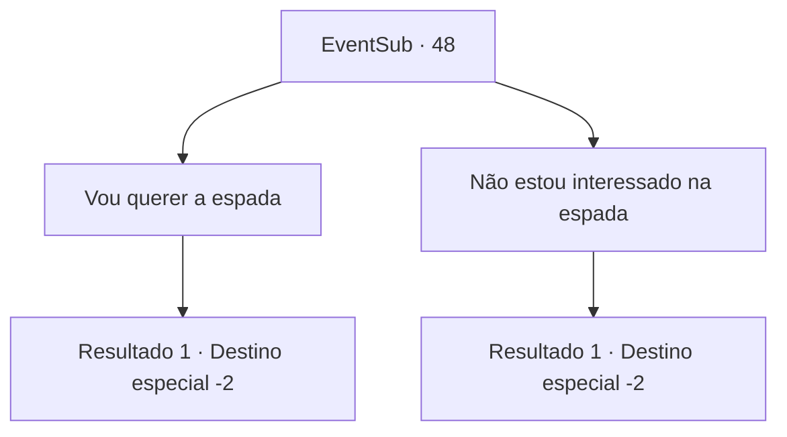

# Eventos secundários · 48

[Índice da tabela](index.md) · [Índice geral](../index.md)

ID: `pt:EventSub:48` · Fonte: `EventSub4` · Versão: 1.2.47.

Mapeamento estático dos arquivos; a disponibilidade e a execução dependem do estado da run.

## Texto do evento

*Sem texto no arquivo.*

## Dados de entrada

```json
{
  "id": 48,
  "grade": 1,
  "subEvent": "2",
  "required": ""
}
```

## Mapa das escolhas



## Escolhas e resultados

### Escolha 1

Vou querer a espada

Requisitos e outros campos da escolha:

```json
{
  "required": ""
}
```

#### Resultado 1.1

Você se oferece para pegar a espada em vez da sua parte do ouro. Os outros concordam. Nenhum deles está interessado na lâmina. Os três dividem o ouro e seguem caminhos separados.

Continuação registrada: [Destino especial `-2`](../destinos-especiais.md).

```json
{
  "required": "",
  "chance": "1",
  "nextEvent": -2,
  "type": 2,
  "reward": "3_92_1|0_2_3|12_2_5|5_200_1"
}
```

### Escolha 2

Não estou interessado na espada

Requisitos e outros campos da escolha:

```json
{
  "required": ""
}
```

#### Resultado 2.1

Você expressa seu desinteresse pela espada. Volga a pega, já que nenhum dos outros está interessado também. Você e os outros dois dividem o ouro e seguem caminhos separados.

Continuação registrada: [Destino especial `-2`](../destinos-especiais.md).

```json
{
  "required": "",
  "chance": "1",
  "nextEvent": -2,
  "type": 2,
  "reward": "0_4_100|0_2_3|12_2_5|5_200_1"
}
```

## Referências que chegam a este evento

- [Evento 46 · escolha 1 · resultado 1](0046.md#escolha-1)
