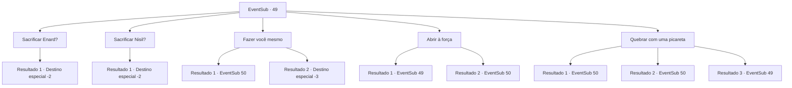

# Eventos secundários · 49

[Índice da tabela](index.md) · [Índice geral](../index.md)

ID: `pt:EventSub:49` · Fonte: `EventSub4` · Versão: 1.2.47.

Mapeamento estático dos arquivos; a disponibilidade e a execução dependem do estado da run.

## Texto do evento

*Sem texto no arquivo.*

## Dados de entrada

```json
{
  "id": 49,
  "grade": 1,
  "subEvent": "2",
  "required": ""
}
```

## Mapa das escolhas



## Escolhas e resultados

### Escolha 1

Sacrificar Enard?

Requisitos e outros campos da escolha:

```json
{
  "required": ""
}
```

#### Resultado 1.1

Você olha para Nisil. Ele parece ter lido sua mente. Vocês dois agarram ENARD e o empurraram pelo buraco. 

 "Vocêshooooooooles!"

 Gritando, ENARD é sugado. 
 . 
 .. 
 ... 
 A porta se abre algum tempo depois. |drawing_emptyCoffin| Apenas um caixão de obsidiano vazio permanece dentro. A porta de saída também está aberta, o que significa que ENARD deve ter reunido todo o tesouro e saiu. Você e Nisil retornam à superfície de mãos vazias.

Continuação registrada: [Destino especial `-2`](../destinos-especiais.md).

```json
{
  "required": "",
  "chance": "1",
  "nextEvent": -2,
  "type": 2,
  "reward": "0_3_-3|12_2_-1|0_2_2|14_2_0"
}
```

### Escolha 2

Sacrificar Nisil?

Requisitos e outros campos da escolha:

```json
{
  "required": ""
}
```

#### Resultado 2.1

Você olha para ENARD. Ele parece ter lido sua mente. Vocês dois agarram Nisil e o empurram no buraco. 

 "Vocês ... filhos de ...!"

 Gritando, Nisil é sugado. 
 . 
 .. 
 ... 
 A porta se abre algum tempo depois. |drawing_emptyCoffin| Apenas um caixão de obsidiano vazio permanece dentro. A porta de saída também está aberta, o que significa que Nisil deve ter reunido todo o tesouro e saiu. Você e ENard retornam à superfície de mãos vazias.

Continuação registrada: [Destino especial `-2`](../destinos-especiais.md).

```json
{
  "required": "",
  "chance": "1",
  "nextEvent": -2,
  "type": 2,
  "reward": "0_3_-3|12_2_-1|0_2_2|14_2_1"
}
```

### Escolha 3

Fazer você mesmo

Requisitos e outros campos da escolha:

```json
{
  "required": ""
}
```

#### Resultado 3.1

Você se oferece para entrar no buraco. Nisil não diz muito quando ele cruza os braços, mas ENARD dá um tapinha nas costas e agradece. O buraco suga você assim que você empurra seu rosto através dele. Parece nojento, como se você estivesse rastejando pelo intestino de uma besta. 

 Quando você chega ao outro lado, vê um caixão obsidiano e vários potes de mármore que o cercam. Você abre o caixão e o encontra cheio de ouro. Um esqueleto abraçando uma espada está no topo da pilha. Você olha dentro dos vasos e encontra órgãos mumificados dentro. |drawing_goldInCoffin|

Continuação registrada: [Evento 50](0050.md) na mesma tabela.

```json
{
  "required": "1_1_2",
  "chance": "1",
  "nextEvent": 50,
  "type": 2,
  "reward": "0_1_-1"
}
```

#### Resultado 3.2

Você se voluntaria para entrar no buraco. Nisil não diz muito enquanto cruza os braços, mas Enard dá tapinhas em suas costas e agradece. O buraco te suga assim que você empurra o rosto através dele. É nojento, como se estivesse rastejando pelos intestinos de uma besta. Você não aguenta e desmaia.

Continuação registrada: [Destino especial `-3`](../destinos-especiais.md).

```json
{
  "required": "2_1_2",
  "chance": "1",
  "nextEvent": -3,
  "type": 2,
  "reward": "0_1_-1"
}
```

### Escolha 4

Abrir à força

Requisitos e outros campos da escolha:

```json
{
  "required": "5_52_0"
}
```

#### Resultado 4.1

Você empurra a porta com toda a sua força. Mas ela nem se mexe.

Continuação registrada: [Evento 49](0049.md) na mesma tabela.

```json
{
  "required": "",
  "chance": "20",
  "nextEvent": 49,
  "type": 1,
  "reward": "5_52_1"
}
```

#### Resultado 4.2

Com sua força incrível, você empurra a enorme porta. Ele abre lentamente, emitindo som de algo quebrando por dentro. Enad e Nisil silenciosamente olham para a vista, não tentando mais se empurrar para dentro. 

 "Pelos deuses ..."

 À medida que a poeira é limpa, você vê um caixão obsidiano e urnas feitas de mármore. O interior do caixão é preenchido com ouro, com um esqueleto segurando firmemente algum tipo de lâmina nos braços. Nas urnas que cercam o caixão estão intestinos mumificados, embrulhados em linho. |drawing_goldInCoffin|

Continuação registrada: [Evento 50](0050.md) na mesma tabela.

```json
{
  "required": "",
  "chance": "1|0_5_1",
  "nextEvent": 50,
  "type": 0,
  "reward": "5_202_1"
}
```

### Escolha 5

Quebrar com uma picareta

Requisitos e outros campos da escolha:

```json
{
  "required": "8_44_1"
}
```

#### Resultado 5.1

Você balança sua picareta. Enad e Nisil silenciosamente olham para a vista, não tentando mais se empurrar para dentro. A enorme porta de pedra começa a quebrar, pouco a pouco. Depois de algum tempo, você abre uma abertura na porta grande o suficiente para que os humanos passem. Mas a picareta quebra em pedaços. 

 Ao passar pelo buraco, você vê um caixão obsidiano e urnas feitas de mármore. O interior do caixão é preenchido com ouro, com um esqueleto segurando firmemente algum tipo de lâmina nos braços. Nas urnas que cercam o caixão estão intestinos mumificados, embrulhados em linho. |drawing_goldInCoffin|

Continuação registrada: [Evento 50](0050.md) na mesma tabela.

```json
{
  "required": "",
  "chance": "1|0_5_1",
  "nextEvent": 50,
  "type": 0,
  "reward": "4_44_1|5_202_1"
}
```

#### Resultado 5.2

Você toca com cuidado a porta de pedra, encontrando um ponto fraco. Você então balança sua picareta com todas as suas forças. A enorme porta de pedra logo fica cheia de rachaduras e desmorona. Enad e Nisil silenciosamente olham para a vista, não tentando mais se empurrar para dentro. 

 Ao entrar na sala, você vê um caixão obsidiano e urnas feitas de mármore. O interior do caixão é preenchido com ouro, com um esqueleto segurando firmemente algum tipo de lâmina nos braços. Nas urnas que cercam o caixão estão intestinos mumificados, embrulhados em linho. |drawing_goldInCoffin|

Continuação registrada: [Evento 50](0050.md) na mesma tabela.

```json
{
  "required": "1_7_20",
  "chance": "1|0_5_2",
  "nextEvent": 50,
  "type": 0,
  "reward": "5_202_1"
}
```

#### Resultado 5.3

Você balança sua picareta com toda a sua força. Ela quebra assim que atinge a porta.

Continuação registrada: [Evento 49](0049.md) na mesma tabela.

```json
{
  "required": "",
  "chance": "15",
  "nextEvent": 49,
  "type": 1,
  "reward": "4_44_1"
}
```

## Referências que chegam a este evento

- [Evento 44 · escolha 1 · resultado 2](0044.md#escolha-1)
- [Evento 44 · escolha 2 · resultado 2](0044.md#escolha-2)
- [Evento 45 · escolha 2 · resultado 1](0045.md#escolha-2)
- [Evento 46 · escolha 2 · resultado 1](0046.md#escolha-2)
- [Evento 47 · escolha 2 · resultado 1](0047.md#escolha-2)
- [Evento 49 · escolha 4 · resultado 1](0049.md#escolha-4)
- [Evento 49 · escolha 5 · resultado 3](0049.md#escolha-5)
