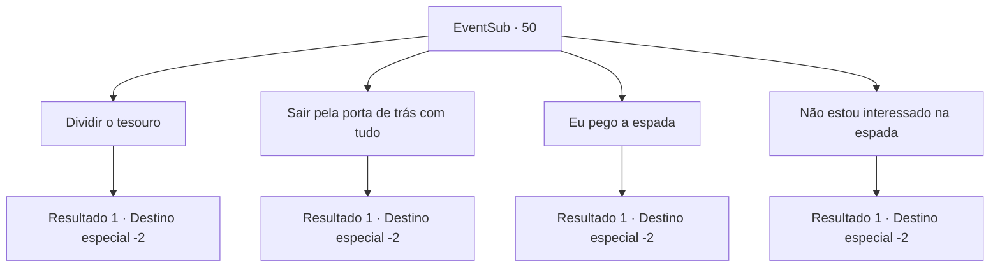

# Eventos secundários · 50

[Índice da tabela](index.md) · [Índice geral](../index.md)

ID: `pt:EventSub:50` · Fonte: `EventSub4` · Versão: 1.2.47.

Mapeamento estático dos arquivos; a disponibilidade e a execução dependem do estado da run.

## Texto do evento

*Sem texto no arquivo.*

## Dados de entrada

```json
{
  "id": 50,
  "grade": 1,
  "subEvent": "2",
  "required": ""
}
```

## Mapa das escolhas



## Escolhas e resultados

### Escolha 1

Dividir o tesouro

Requisitos e outros campos da escolha:

```json
{
  "required": "18_202_1"
}
```

#### Resultado 1.1

Você olha ao redor e encontra uma alavanca no canto. Você puxa e ouve engrenagens girando. Lentamente, a porta se abre. Enard e Nisil ficam surpresos ao te verem novamente. 

 "Nós... nós pensamos que você estava morto."

 Você dá de ombros e segue em frente para dividir o tesouro com eles. Enard silenciosamente pega sua parte, e Nisil agradece pelo que você fez. Vocês se separam depois disso.

Continuação registrada: [Destino especial `-2`](../destinos-especiais.md).

```json
{
  "required": "",
  "chance": "1",
  "nextEvent": -2,
  "type": 2,
  "reward": "0_3_5|0_4_100|3_92_1|12_2_7|0_2_3"
}
```

### Escolha 2

Sair pela porta de trás com  tudo

Requisitos e outros campos da escolha:

```json
{
  "required": "18_202_1"
}
```

#### Resultado 2.1

Você decide reivindicar todo o tesouro para si mesmo. Você empacota todo o ouro e pega a espada também. Então você sai pela porta dos fundos.

Continuação registrada: [Destino especial `-2`](../destinos-especiais.md).

```json
{
  "required": "",
  "chance": "1",
  "nextEvent": -2,
  "type": 2,
  "reward": "0_4_200|3_92_1|12_2_-1|0_2_3|14_2_2"
}
```

### Escolha 3

Eu pego a espada

Requisitos e outros campos da escolha:

```json
{
  "required": "5_202_1"
}
```

#### Resultado 3.1

Você diz que vai pegar a espada em vez do ouro. Os outros não estão tão interessados na espada mesmo, então eles concordam com a cabeça. Enad e Nisil dividem o monte de ouro e se despedem.

Continuação registrada: [Destino especial `-2`](../destinos-especiais.md).

```json
{
  "required": "",
  "chance": "1",
  "nextEvent": -2,
  "type": 2,
  "reward": "3_92_1|0_2_3|12_2_7"
}
```

### Escolha 4

Não estou interessado na  espada

Requisitos e outros campos da escolha:

```json
{
  "required": "5_202_1"
}
```

#### Resultado 4.1

Você diz que não está interessado na espada. Os outros também não estão tão interessados na espada, então depois de uma partida de pedra, papel e tesoura, Nisil acaba ficando com a espada. Você e Enad dividem o monte de ouro e se despedem.

Continuação registrada: [Destino especial `-2`](../destinos-especiais.md).

```json
{
  "required": "",
  "chance": "1",
  "nextEvent": -2,
  "type": 2,
  "reward": "0_4_100|0_2_3|12_2_7"
}
```

## Referências que chegam a este evento

- [Evento 49 · escolha 3 · resultado 1](0049.md#escolha-3)
- [Evento 49 · escolha 4 · resultado 2](0049.md#escolha-4)
- [Evento 49 · escolha 5 · resultado 1](0049.md#escolha-5)
- [Evento 49 · escolha 5 · resultado 2](0049.md#escolha-5)
