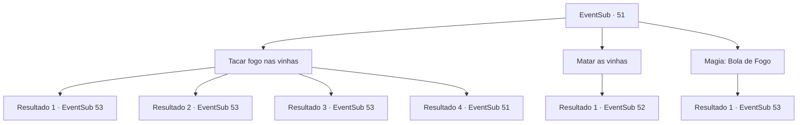

# Eventos secundários · 51

[Índice da tabela](index.md) · [Índice geral](../index.md)

ID: `pt:EventSub:51` · Fonte: `EventSub4` · Versão: 1.2.47.

Mapeamento estático dos arquivos; a disponibilidade e a execução dependem do estado da run.

## Texto do evento

|drawing_sadGrave| Você chega á Tumba da Cinzenta Aflição com base no que ouviu dos andarilhos. Está coberto de trepadeiras escuras e pegajosas. Você ouve um pequeno grito de dentro da câmara de pedra localizada no centro.

## Dados de entrada

```json
{
  "id": 51,
  "grade": 1,
  "subEvent": "2",
  "required": "12_2_3"
}
```

## Mapa das escolhas



## Escolhas e resultados

### Escolha 1

Tacar fogo nas vinhas

Requisitos e outros campos da escolha:

```json
{
  "required": "5_51_0"
}
```

#### Resultado 1.1

Você acende um fósforo e o joga nas vinhas. Elas instantaneamente se incendeiam e queimam até o chão. Você segue em frente através da fumaça em direção à câmara de pedra no centro. Está completamente escuro lá dentro. Você não consegue ver nada.

Continuação registrada: [Evento 53](0053.md) na mesma tabela.

```json
{
  "required": "8_40_1",
  "chance": "1",
  "nextEvent": 53,
  "type": 2,
  "reward": "4_40_1"
}
```

#### Resultado 1.2

Você acende um fósforo e o joga nas vinhas. Elas instantaneamente se incendeiam e queimam até o chão. Você segue em frente através da fumaça em direção à câmara de pedra no centro. Está completamente escuro lá dentro. Você não consegue ver nada.

Continuação registrada: [Evento 53](0053.md) na mesma tabela.

```json
{
  "required": "8_42_1",
  "chance": "1",
  "nextEvent": 53,
  "type": 2,
  "reward": "4_42_1"
}
```

#### Resultado 1.3

Você acende um fósforo e o joga nas vinhas. Elas instantaneamente se incendeiam e queimam até o chão. Você segue em frente através da fumaça em direção à câmara de pedra no centro. Está completamente escuro lá dentro. Você não consegue ver nada.

Continuação registrada: [Evento 53](0053.md) na mesma tabela.

```json
{
  "required": "8_47_1",
  "chance": "1",
  "nextEvent": 53,
  "type": 2,
  "reward": "4_47_1"
}
```

#### Resultado 1.4

Você considera colocar fogo nas videiras, mas percebe que não tem as ferramentas certas.

Continuação registrada: [Evento 51](0051.md) na mesma tabela.

```json
{
  "required": "10_42_1|10_47_1|10_40_1",
  "chance": "1",
  "nextEvent": 51,
  "type": 2,
  "reward": "5_51_1"
}
```

### Escolha 2

Matar as vinhas

Requisitos e outros campos da escolha:

```json
{
  "required": ""
}
```

#### Resultado 2.1

Você balança sua arma nas vinhas. Elas se contorcem de dor e tentam se enrolar em volta de você.

Continuação registrada: [Evento 52](0052.md) na mesma tabela.

```json
{
  "required": "",
  "chance": "1",
  "nextEvent": 52,
  "type": 2,
  "reward": "6_0_64",
  "place": 1
}
```

### Escolha 3

Magia: Bola de Fogo

Requisitos e outros campos da escolha:

```json
{
  "required": "20_0_2|1_1_2"
}
```

#### Resultado 3.1

Você produz uma bola de fogo em suas pontas dos dedos e queima todas as vinhas. Você se abre caminho através da fumaça em direção à câmara de pedra no centro. Está completamente escuro lá dentro. Você não consegue ver nada.

Continuação registrada: [Evento 53](0053.md) na mesma tabela.

```json
{
  "required": "",
  "chance": "1",
  "nextEvent": 53,
  "type": 2,
  "reward": "0_2_1|0_1_-1"
}
```

## Referências que chegam a este evento

- [Evento 51 · escolha 1 · resultado 4](0051.md#escolha-1)
