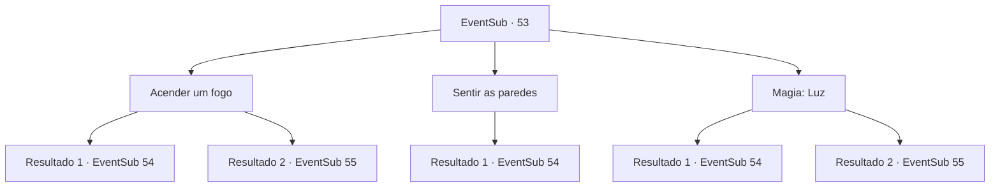

# Eventos secundários · 53

[Índice da tabela](index.md) · [Índice geral](../index.md)

ID: `pt:EventSub:53` · Fonte: `EventSub4` · Versão: 1.2.47.

Mapeamento estático dos arquivos; a disponibilidade e a execução dependem do estado da run.

## Texto do evento

*Sem texto no arquivo.*

## Dados de entrada

```json
{
  "id": 53,
  "grade": 1,
  "subEvent": "2",
  "required": ""
}
```

## Mapa das escolhas



## Escolhas e resultados

### Escolha 1

Acender um fogo

Requisitos e outros campos da escolha:

```json
{
  "required": "8_42_1"
}
```

#### Resultado 1.1

Você pega uma lanterna sobressalente da mochila e a acende. As teias de aranha empoeiradas cobrem as paredes, gravadas com padrões geométricos místicos. Com cuidado, você começa a viajar para dentro. 

 Logo você chega a uma pequena porta de pedra. Você empurra, |drawing_hangingBats|e milhares de morcegos voam em sua direção.

Continuação registrada: [Evento 54](0054.md) na mesma tabela.

```json
{
  "required": "",
  "chance": "9",
  "nextEvent": 54,
  "type": 1,
  "reward": "6_0_66",
  "place": 6
}
```

#### Resultado 1.2

Você pega uma lanterna sobressalente da mochila e a acende. As teias de aranha empoeiradas cobrem as paredes, gravadas com padrões geométricos místicos. Com cuidado, você começa a viajar para dentro. 

 Logo você chega a uma pequena porta de pedra. Você ouve sons do outro lado. Você espia pela porta o mais silenciosamente possível e vê milhares de morcegos pendurados no teto. |drawing_hangingBats| Você abaixa a lanterna e rasteja silenciosamente pelos morcegos. 

 Depois de passar por um corredor estreito, você se depara com uma porta de pedra gigante. A escrita sobre ele diz 'um pagará no sangue' e você notará um buraco perto do fundo grande o suficiente para se encaixar em uma pessoa.

Continuação registrada: [Evento 55](0055.md) na mesma tabela.

```json
{
  "required": "",
  "chance": "1|0_14_1",
  "nextEvent": 55,
  "type": 0,
  "reward": "4_42_1"
}
```

### Escolha 2

Sentir as paredes

Requisitos e outros campos da escolha:

```json
{
  "required": ""
}
```

#### Resultado 2.1

Você toca nas paredes da câmara para obter orientação à medida que avança lentamente. De repente, um dos tijolos em que você toca desliza. O chão se inclina para a frente e envia deslizando. Você empurra a porta que entra. Milhares de morcegos estão esperando por você do outro lado. Eles descem do teto e vêm voando em sua direção. |drawing_hangingBats|

Continuação registrada: [Evento 54](0054.md) na mesma tabela.

```json
{
  "required": "",
  "chance": "1",
  "nextEvent": 54,
  "type": 1,
  "reward": "6_3_66",
  "place": 6
}
```

### Escolha 3

Magia: Luz

Requisitos e outros campos da escolha:

```json
{
  "required": "20_0_1"
}
```

#### Resultado 3.1

Você pega uma lanterna sobressalente da mochila e a acende. As teias de aranha empoeiradas cobrem as paredes, gravadas com padrões geométricos místicos. Com cuidado, você começa a viajar para dentro. 

 Logo você chega a uma pequena porta de pedra. Você empurra, |drawing_hangingBats| e milhares de morcegos voam em roward você.

Continuação registrada: [Evento 54](0054.md) na mesma tabela.

```json
{
  "required": "",
  "chance": "9",
  "nextEvent": 54,
  "type": 1,
  "reward": "6_0_66",
  "place": 6
}
```

#### Resultado 3.2

Você produz uma pequena fonte de luz mágica. As teias de aranha empoeiradas cobrem as paredes, gravadas com padrões geométricos místicos. Com cuidado, você começa a viajar para dentro. 

 Logo você chega a uma pequena porta de pedra. Você ouve sons do outro lado. Você espia pela porta o mais silenciosamente possível e vê milhares de morcegos pendurados no teto. |drawing_hangingBats| Você abaixa a lanterna e rasteja silenciosamente pelos morcegos. 

 Depois de passar por um corredor estreito, você se depara com uma porta de pedra gigante. A escrita sobre ele diz 'um pagará no sangue' e você notará um buraco perto do fundo grande o suficiente para se encaixar em uma pessoa.

Continuação registrada: [Evento 55](0055.md) na mesma tabela.

```json
{
  "required": "",
  "chance": "1|0_14_1",
  "nextEvent": 55,
  "type": 0,
  "reward": ""
}
```

## Referências que chegam a este evento

- [Evento 51 · escolha 1 · resultado 1](0051.md#escolha-1)
- [Evento 51 · escolha 1 · resultado 2](0051.md#escolha-1)
- [Evento 51 · escolha 1 · resultado 3](0051.md#escolha-1)
- [Evento 51 · escolha 3 · resultado 1](0051.md#escolha-3)
- [Evento 52 · escolha 1 · resultado 1](0052.md#escolha-1)
