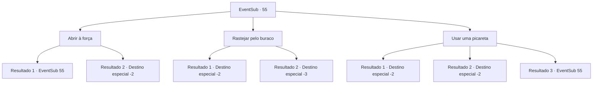

# Eventos secundários · 55

[Índice da tabela](index.md) · [Índice geral](../index.md)

ID: `pt:EventSub:55` · Fonte: `EventSub4` · Versão: 1.2.47.

Mapeamento estático dos arquivos; a disponibilidade e a execução dependem do estado da run.

## Texto do evento

*Sem texto no arquivo.*

## Dados de entrada

```json
{
  "id": 55,
  "grade": 1,
  "subEvent": "2",
  "required": ""
}
```

## Mapa das escolhas



## Escolhas e resultados

### Escolha 1

Abrir à força

Requisitos e outros campos da escolha:

```json
{
  "required": "5_52_0"
}
```

#### Resultado 1.1

Você empurra a porta com toda a sua força. Mas ela nem se mexe.

Continuação registrada: [Evento 55](0055.md) na mesma tabela.

```json
{
  "required": "",
  "chance": "20",
  "nextEvent": 55,
  "type": 1,
  "reward": "5_52_1"
}
```

#### Resultado 1.2

Você empurra a porta com toda a sua força. Algo do outro lado quebra quando a porta se abre lentamente. Depois que a poeira se acalma, você vê um caixão obsidiano cercado por vários vasos de mármore. Você abre o caixão e o encontra cheio de ouro. Um esqueleto abraçando uma espada está no topo da pilha. Você olha dentro dos vasos e encontra órgãos mumificados dentro. |drawing_goldInCoffin| Você pega todo o ouro junto com a espada do esqueleto. Então você sai através de uma porta dos fundos que leva para fora.

Continuação registrada: [Destino especial `-2`](../destinos-especiais.md).

```json
{
  "required": "",
  "chance": "1|0_5_1",
  "nextEvent": -2,
  "type": 0,
  "reward": "0_4_200|3_92_1|12_2_-1|0_2_3|14_2_9"
}
```

### Escolha 2

Rastejar pelo buraco

Requisitos e outros campos da escolha:

```json
{
  "required": ""
}
```

#### Resultado 2.1

Você se empurra pelo buraco perto do fundo. Parece nojento, como se você estivesse rastejando pelo intestino de uma besta. Você estremece em repulsão ao chegar ao outro lado. 

 Você vê um caixão obsidiano e vários potes de mármore que o cercam. Você abre o caixão e o encontra cheio de ouro. Um esqueleto abraçando uma espada está no topo da pilha. Você olha dentro dos vasos e encontra órgãos mumificados dentro. |drawing_goldInCoffin| Você pega todo o ouro junto com a espada do esqueleto. Então você sai através de uma porta dos fundos que leva para fora.

Continuação registrada: [Destino especial `-2`](../destinos-especiais.md).

```json
{
  "required": "1_1_2",
  "chance": "1",
  "nextEvent": -2,
  "type": 2,
  "reward": "0_4_200|3_92_1|0_1_-1|12_2_-1|0_2_3|14_2_9"
}
```

#### Resultado 2.2

Você se empurra através do buraco perto do fundo. É nojento, como se estivesse rastejando pelos intestinos de uma besta. Sua mente não é forte o suficiente e se desliga.

Continuação registrada: [Destino especial `-3`](../destinos-especiais.md).

```json
{
  "required": "2_1_2",
  "chance": "1",
  "nextEvent": -3,
  "type": 2,
  "reward": "0_1_-1"
}
```

### Escolha 3

Usar uma picareta

Requisitos e outros campos da escolha:

```json
{
  "required": "8_44_1"
}
```

#### Resultado 3.1

Você balança sua picareta com toda a sua força. Pouco a pouco, a porta se afasta. Você consegue cavar um buraco grande o suficiente para uma pessoa depois do que parece ser uma eternidade. A picareta agora está quebrada além do reparo. 

 Você sobe pelo buraco e vê um caixão obsidiano cercado por vários vasos de mármore. Você abre o caixão e o encontra cheio de ouro. Um esqueleto abraçando uma espada está no topo da pilha. Você olha dentro dos vasos e encontra órgãos mumificados dentro. |drawing_goldInCoffin| Você pega todo o ouro junto com a espada do esqueleto. Então você sai através de uma porta dos fundos que leva para fora.

Continuação registrada: [Destino especial `-2`](../destinos-especiais.md).

```json
{
  "required": "",
  "chance": "1|0_5_1",
  "nextEvent": -2,
  "type": 0,
  "reward": "0_4_200|3_92_1|4_44_1|12_2_-1|0_2_3|14_2_9"
}
```

#### Resultado 3.2

Você sente a superfície da porta para pontos fracos. Você encontra um e atinge -o com sua picareta. A porta racha e desmorona em pedaços.  No interior, você vê um caixão obsidiano cercado por vários vasos de mármore. Você abre o caixão e o encontra cheio de ouro. Um esqueleto abraçando uma espada está no topo da pilha. Você olha dentro dos vasos e encontra órgãos mumificados dentro. |drawing_goldInCoffin| Você pega todo o ouro junto com a espada do esqueleto. Então você sai através de uma porta dos fundos que leva para fora.

Continuação registrada: [Destino especial `-2`](../destinos-especiais.md).

```json
{
  "required": "1_7_20",
  "chance": "1|0_5_2",
  "nextEvent": -2,
  "type": 0,
  "reward": "0_4_200|3_92_1|12_2_-1|0_2_3|14_2_9"
}
```

#### Resultado 3.3

Você balança sua picareta com toda a sua força. Ela quebra assim que atinge a porta.

Continuação registrada: [Evento 55](0055.md) na mesma tabela.

```json
{
  "required": "",
  "chance": "15",
  "nextEvent": 55,
  "type": 1,
  "reward": "4_44_1"
}
```

## Referências que chegam a este evento

- [Evento 53 · escolha 1 · resultado 2](0053.md#escolha-1)
- [Evento 53 · escolha 3 · resultado 2](0053.md#escolha-3)
- [Evento 54 · escolha 1 · resultado 1](0054.md#escolha-1)
- [Evento 54 · escolha 2 · resultado 1](0054.md#escolha-2)
- [Evento 55 · escolha 1 · resultado 1](0055.md#escolha-1)
- [Evento 55 · escolha 3 · resultado 3](0055.md#escolha-3)
