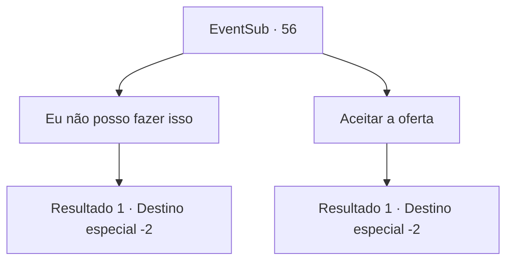

# Eventos secundários · 56

[Índice da tabela](index.md) · [Índice geral](../index.md)

ID: `pt:EventSub:56` · Fonte: `EventSub4` · Versão: 1.2.47.

Mapeamento estático dos arquivos; a disponibilidade e a execução dependem do estado da run.

## Texto do evento

|drawing_hof| Você visita um bar cheio de aventureiros cansados. Você encontra o anão que explorou a Tumba da Cinzenta Aflição com você. Volga para de se gabar de suas façanhas para seus amigos anões e acena para você. 

 "Bom ver você de novo, velho amigo! Este é o que eu tenho falado! Aquele que estava na Tumba da Cinzenta Aflição comigo!"

 Um anão de vermelho grita de volta. 

 "Grande coisa! Isso não é nada comparado a como eu, Abenson, matei sozinho um wyvern!"

 A multidão anã parece impressionada. Volga sente essa mudança na atmosfera e decide fazer algo ainda maior. Então ele bebe uma caneca inteira de cerveja e te arrasta para o fundo do bar. 

 "Eu não posso deixar esse ninguém-Abenson me humilhar assim. Ajude-me com o dragão, sim?"


## Dados de entrada

```json
{
  "id": 56,
  "grade": 1,
  "subEvent": "2",
  "required": "12_2_5|1_2_60"
}
```

## Mapa das escolhas



## Escolhas e resultados

### Escolha 1

Eu não posso fazer isso

Requisitos e outros campos da escolha:

```json
{
  "required": ""
}
```

#### Resultado 1.1

Você recusa o pedido de Volga. Ele lambe os lábios desapontado. 

 "Tudo bem... Acho que vou perguntar para Enard e Nisil, então."

 Ele se afasta em passos curtos e rápidos.

Continuação registrada: [Destino especial `-2`](../destinos-especiais.md).

```json
{
  "required": "",
  "chance": "1",
  "nextEvent": -2,
  "type": 2,
  "reward": "12_2_-1|5_200_2|14_2_10"
}
```

### Escolha 2

Aceitar a oferta

Requisitos e outros campos da escolha:

```json
{
  "required": ""
}
```

#### Resultado 2.1

Você concorda em ajudá-lo. Ele acaricia a barba com satisfação. 

 "Excelente! Você segue em frente e me espera no Lago Salmon, eu vou ficar aqui e recrutar mais pessoas."

 Então ele se afasta em passos curtos e rápidos.

Continuação registrada: [Destino especial `-2`](../destinos-especiais.md).

```json
{
  "required": "",
  "chance": "1",
  "nextEvent": -2,
  "type": 2,
  "reward": "12_2_6"
}
```

## Referências que chegam a este evento

Nenhum `nextEvent` positivo da mesma tabela aponta para este nó. Isso não prova que seja inacessível: sorteio e estado de história podem selecioná-lo.

