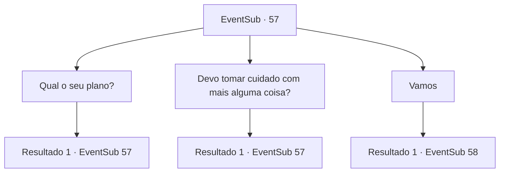

# Eventos secundários · 57

[Índice da tabela](index.md) · [Índice geral](../index.md)

ID: `pt:EventSub:57` · Fonte: `EventSub4` · Versão: 1.2.47.

Mapeamento estático dos arquivos; a disponibilidade e a execução dependem do estado da run.

## Texto do evento

Você encontra Volga no Lago do Salmão como prometido. Ele trouxe Enard e Nisil. 

 "Agora, o dragão que estamos procurando é um branco."

 Volga começa a explicar os detalhes. |drawing_whiteMountain| Segundo ele, o covil do dragão branco está localizado perto do topo do Monte Whitehead, cerca de 5.400 metros acima do nível do mar.

## Dados de entrada

```json
{
  "id": 57,
  "grade": 1,
  "subEvent": "2",
  "required": "12_2_6"
}
```

## Mapa das escolhas



## Escolhas e resultados

### Escolha 1

Qual o seu plano?

Requisitos e outros campos da escolha:

```json
{
  "required": "5_54_0"
}
```

#### Resultado 1.1

Você pergunta a Volga o que ele planeja fazer. Ele franze a testa como se não entendesse. 

 "Eu vou dividir o crânio dele com esse machado, o que mais?"

 Volga não tem um plano. Enard percebe isso e tenta pensar em um. 

 "Eu ouvi rumores de um gigante de gelo vivendo em Whitehead. Gigantes e dragões são inimigos jurados. Talvez possamos usar isso a nosso favor."


Continuação registrada: [Evento 57](0057.md) na mesma tabela.

```json
{
  "required": "",
  "chance": "1",
  "nextEvent": 57,
  "type": 2,
  "reward": "5_54_1"
}
```

### Escolha 2

Devo tomar cuidado com mais alguma coisa?

Requisitos e outros campos da escolha:

```json
{
  "required": "5_55_0"
}
```

#### Resultado 2.1

Você pergunta se há mais alguma coisa com a qual você deva se preocupar. Nisil interrompe. 

 "O ar é escasso lá em cima. Também precisamos nos preparar contra a geada."

 Aparentemente, ele já se preparou.

Continuação registrada: [Evento 57](0057.md) na mesma tabela.

```json
{
  "required": "",
  "chance": "1",
  "nextEvent": 57,
  "type": 2,
  "reward": "5_55_1"
}
```

### Escolha 3

Vamos

Requisitos e outros campos da escolha:

```json
{
  "required": ""
}
```

#### Resultado 3.1

Os quatro de vocês seguem para o covil do dragão branco. Felizmente, o céu está limpo e vocês conseguem ver até o topo da montanha. O frio é suportável, mas fica cada vez mais difícil respirar. Vocês estão na metade da montanha quando um gigante de gelo surge da neve na sua frente. 

 "O que há, anões."


Continuação registrada: [Evento 58](0058.md) na mesma tabela.

```json
{
  "required": "",
  "chance": "1",
  "nextEvent": 58,
  "type": 2,
  "reward": ""
}
```

## Referências que chegam a este evento

- [Evento 57 · escolha 1 · resultado 1](0057.md#escolha-1)
- [Evento 57 · escolha 2 · resultado 1](0057.md#escolha-2)
