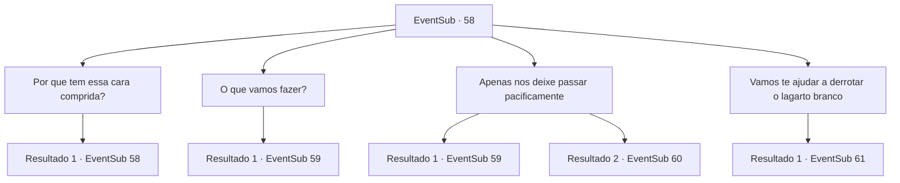

# Eventos secundários · 58

[Índice da tabela](index.md) · [Índice geral](../index.md)

ID: `pt:EventSub:58` · Fonte: `EventSub4` · Versão: 1.2.47.

Mapeamento estático dos arquivos; a disponibilidade e a execução dependem do estado da run.

## Texto do evento

*Sem texto no arquivo.*

## Dados de entrada

```json
{
  "id": 58,
  "grade": 1,
  "subEvent": "2",
  "required": ""
}
```

## Mapa das escolhas



## Escolhas e resultados

### Escolha 1

Por que tem essa cara comprida?

Requisitos e outros campos da escolha:

```json
{
  "required": "1_14_10|5_54_1"
}
```

#### Resultado 1.1

Você pergunta, percebendo seu mau humor. O gigante de gelo responde. 

 "É aquele maldito lagarto albino, está me irritando."

 Você percebe que ele está falando sobre o dragão branco.

Continuação registrada: [Evento 58](0058.md) na mesma tabela.

```json
{
  "required": "",
  "chance": "1",
  "nextEvent": 58,
  "type": 2,
  "reward": "5_54_2"
}
```

### Escolha 2

O que vamos fazer?

Requisitos e outros campos da escolha:

```json
{
  "required": ""
}
```

#### Resultado 2.1

Volga avança com seu machado antes que você possa fazer qualquer coisa. Enard e Nisil correm atrás dele relutantemente, armas em punho.

Continuação registrada: [Evento 59](0059.md) na mesma tabela.

```json
{
  "required": "",
  "chance": "1",
  "nextEvent": 59,
  "type": 2,
  "reward": "6_0_42",
  "place": 9
}
```

### Escolha 3

Apenas nos deixe passar pacificamente

Requisitos e outros campos da escolha:

```json
{
  "required": ""
}
```

#### Resultado 3.1

Você pede ao gigante de gelo para deixá-lo seguir em paz. O gigante não está ouvindo, e você percebe a saliva em suas mandíbulas. 

 "Viu isso? Está babando!"

 Volga tira seu machado de duas lâminas. Os outros dois também sacam suas armas, recusando-se a se tornarem comida de gigante.

Continuação registrada: [Evento 59](0059.md) na mesma tabela.

```json
{
  "required": "",
  "chance": "17",
  "nextEvent": 59,
  "type": 1,
  "reward": "6_3_42",
  "place": 9
}
```

#### Resultado 3.2

Você pede ao gigante da geada para permitir que você continue em paz. O gigante do gelo se afasta, sobrecarregado pelo seu carisma ardente. A equipe segue você com um olhar de choque e admiração em seus rostos. 

 Algum tempo depois, uma enorme sombra paira sobre o céu. Você olha para cima e percebe algo bloqueando o sol. |drawing_whiteDragon| É o dragão branco. Um grito rasga o ar enquanto dispara respiração gelada. ENARD e NISIL se transformam instantaneamente em blocos de gelo.

Continuação registrada: [Evento 60](0060.md) na mesma tabela.

```json
{
  "required": "",
  "chance": "1|0_12_1",
  "nextEvent": 60,
  "type": 0,
  "reward": "0_2_3|6_0_56",
  "place": 9
}
```

### Escolha 4

Vamos te ajudar a derrotar o lagarto branco

Requisitos e outros campos da escolha:

```json
{
  "required": "5_54_2"
}
```

#### Resultado 4.1

Você oferece o que o gigante da geada deseja. Ele ri e responde. 

 "Bom Bom. Você parece mais forte do que a maioria dos outros anões também ... eu poderia usar sua ajuda."

 O gigante leva você ao covil do dragão branco. Volga salta um pouco do chão toda vez que o gigante dá um passo. 

 Algum tempo depois, uma enorme sombra paira sobre o céu. Você olha para cima e percebe algo bloqueando o sol. |drawing_whiteDragon| É o dragão branco. Um grito rasga o ar enquanto ele dispara respiração gelada. 
 Mas o gigante bloqueia com seu corpo. Ninguém é afetado. O dragão pousa na neve e os gritos da gigante da geada. 

 "Agora, anões!"

 Volga lidera o resto de vocês, brandindo o machado dele.

Continuação registrada: [Evento 61](0061.md) na mesma tabela.

```json
{
  "required": "",
  "chance": "1",
  "nextEvent": 61,
  "type": 2,
  "reward": "6_2_56",
  "place": 9
}
```

## Referências que chegam a este evento

- [Evento 57 · escolha 3 · resultado 1](0057.md#escolha-3)
- [Evento 58 · escolha 1 · resultado 1](0058.md#escolha-1)
