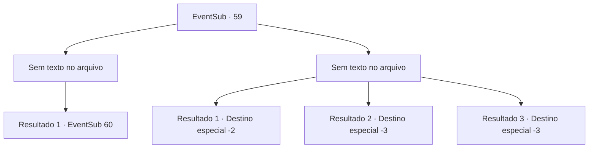

# Eventos secundários · 59

[Índice da tabela](index.md) · [Índice geral](../index.md)

ID: `pt:EventSub:59` · Fonte: `EventSub4` · Versão: 1.2.47.

Mapeamento estático dos arquivos; a disponibilidade e a execução dependem do estado da run.

## Texto do evento

*Sem texto no arquivo.*

## Dados de entrada

```json
{
  "id": 59,
  "grade": 1,
  "subEvent": "2",
  "required": ""
}
```

## Mapa das escolhas



## Escolhas e resultados

### Escolha 1

*Sem texto no arquivo; o papel dessa opção depende da interface do jogo.*

Requisitos e outros campos da escolha:

```json
{
  "required": ""
}
```

#### Resultado 1.1

O gigante cai com um barulho alto. A neve avermelhar com seu sangue. Você mal recupera o fôlego quando uma enorme sombra paira sobre o céu. Você olha para cima e percebe algo bloqueando o sol. |drawing_whiteDragon| É o dragão branco. Um grito rasga o ar enquanto dispara respiração gelada. Enard e Nisil se transformam instantaneamente em blocos de gelo.

Continuação registrada: [Evento 60](0060.md) na mesma tabela.

```json
{
  "required": "",
  "chance": "1",
  "nextEvent": 60,
  "type": 2,
  "reward": "6_0_56|5_200_2",
  "place": 9
}
```

### Escolha 2

*Sem texto no arquivo; o papel dessa opção depende da interface do jogo.*

Requisitos e outros campos da escolha:

```json
{
  "required": ""
}
```

#### Resultado 2.1

O gigante de gelo come Enard no almoço. Você, Volga e Nisil mal conseguem escapar. Os três de vocês se dispersam em direções diferentes sem sequer vislumbrar o dragão.

Continuação registrada: [Destino especial `-2`](../destinos-especiais.md).

```json
{
  "required": "1_0_2|1_1_2",
  "chance": "1",
  "nextEvent": -2,
  "type": 2,
  "reward": "0_0_-1|0_1_-1|12_2_-1|0_2_1|5_200_1|14_2_11"
}
```

#### Resultado 2.2

O gigante de gelo come você e Enard no almoço.

Continuação registrada: [Destino especial `-3`](../destinos-especiais.md).

```json
{
  "required": "2_0_2",
  "chance": "1",
  "nextEvent": -3,
  "type": 2,
  "reward": "0_0_-1|0_1_-1"
}
```

#### Resultado 2.3

O gigante de gelo come você e Enard no almoço.

Continuação registrada: [Destino especial `-3`](../destinos-especiais.md).

```json
{
  "required": "2_1_2",
  "chance": "1",
  "nextEvent": -3,
  "type": 2,
  "reward": "0_0_-1|0_1_-1"
}
```

## Referências que chegam a este evento

- [Evento 58 · escolha 2 · resultado 1](0058.md#escolha-2)
- [Evento 58 · escolha 3 · resultado 1](0058.md#escolha-3)
