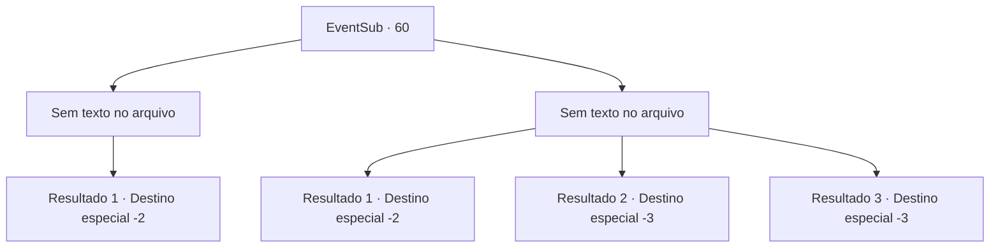

# Eventos secundários · 60

[Índice da tabela](index.md) · [Índice geral](../index.md)

ID: `pt:EventSub:60` · Fonte: `EventSub4` · Versão: 1.2.47.

Mapeamento estático dos arquivos; a disponibilidade e a execução dependem do estado da run.

## Texto do evento

*Sem texto no arquivo.*

## Dados de entrada

```json
{
  "id": 60,
  "grade": 1,
  "subEvent": "2",
  "required": ""
}
```

## Mapa das escolhas



## Escolhas e resultados

### Escolha 1

*Sem texto no arquivo; o papel dessa opção depende da interface do jogo.*

Requisitos e outros campos da escolha:

```json
{
  "required": ""
}
```

#### Resultado 1.1

Com um último golpe, o dragão branco cai desabando na neve. Volga se joga e solta uma risada. 

 "Hahahaha! E aí, Abenson? Você, boca grande, saco de merda insignificante!"

 Ele está animado para compartilhar sua nova história épica com todos. Vocês dividem o saque. Ele pega a cabeça do dragão e você pega o coração. Vocês se despedem acenando um para o outro e seguem caminhos diferentes.

Continuação registrada: [Destino especial `-2`](../destinos-especiais.md).

```json
{
  "required": "",
  "chance": "1",
  "nextEvent": -2,
  "type": 2,
  "reward": "0_2_3|3_113_1|12_2_-1|14_2_3"
}
```

### Escolha 2

*Sem texto no arquivo; o papel dessa opção depende da interface do jogo.*

Requisitos e outros campos da escolha:

```json
{
  "required": ""
}
```

#### Resultado 2.1

A cauda do dragão te atinge e te faz despencar na neve. Volga se junta aos outros e se transforma em um bloco de gelo. Você aplica pressão em seu ferimento e sai mancando.

Continuação registrada: [Destino especial `-2`](../destinos-especiais.md).

```json
{
  "required": "1_0_2|1_1_2",
  "chance": "1",
  "nextEvent": -2,
  "type": 2,
  "reward": "0_0_-1|0_1_-1|14_2_13|12_2_-1|0_2_1|5_200_2"
}
```

#### Resultado 2.2

Você se transforma em um bloco de gelo como os outros. Todos vocês acabam no estômago do dragão.

Continuação registrada: [Destino especial `-3`](../destinos-especiais.md).

```json
{
  "required": "2_0_2",
  "chance": "1",
  "nextEvent": -3,
  "type": 2,
  "reward": "0_0_-1|0_1_-1"
}
```

#### Resultado 2.3

Você se transforma em um bloco de gelo como os outros. Todos vocês acabam no estômago do dragão.

Continuação registrada: [Destino especial `-3`](../destinos-especiais.md).

```json
{
  "required": "2_1_2",
  "chance": "1",
  "nextEvent": -3,
  "type": 2,
  "reward": "0_0_-1|0_1_-1"
}
```

## Referências que chegam a este evento

- [Evento 58 · escolha 3 · resultado 2](0058.md#escolha-3)
- [Evento 59 · escolha 1 · resultado 1](0059.md#escolha-1)
