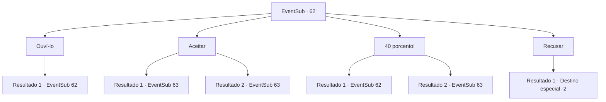

# Eventos secundários · 62

[Índice da tabela](index.md) · [Índice geral](../index.md)

ID: `pt:EventSub:62` · Fonte: `EventSub4` · Versão: 1.2.47.

Mapeamento estático dos arquivos; a disponibilidade e a execução dependem do estado da run.

## Texto do evento

Você encontra Enard novamente em uma parte lotada da cidade. Ele estava com você em sua jornada para a Tumba da Cinzenta Aflição. Ele está aparentemente muito melhor do que antes, a julgar pelo quão limpas e elegantes suas roupas são. 

 "Bom te ver de novo. Especialmente porque eu estava realmente recrutando pessoas para um trabalho."

 Ele pergunta se você está interessado.

## Dados de entrada

```json
{
  "id": 62,
  "grade": 1,
  "subEvent": "2",
  "required": "12_2_7"
}
```

## Mapa das escolhas



## Escolhas e resultados

### Escolha 1

Ouví-lo

Requisitos e outros campos da escolha:

```json
{
  "required": "5_56_0"
}
```

#### Resultado 1.1

Você pergunta que tipo de trabalho é. Ele te leva para um beco vazio e verifica se ninguém está ouvindo antes de explicar. De acordo com ele, um comerciante chamado Cecil Leo passará em breve pela cidade. A carruagem dela está cheia de seda, que Enard planeja roubar. O tecido vale pelo menos 1000 ouros, e ele oferece a você uma parte de 30 por cento.

Continuação registrada: [Evento 62](0062.md) na mesma tabela.

```json
{
  "required": "",
  "chance": "1",
  "nextEvent": 62,
  "type": 2,
  "reward": "5_56_1"
}
```

### Escolha 2

Aceitar

Requisitos e outros campos da escolha:

```json
{
  "required": ""
}
```

#### Resultado 2.1

Você concorda em ajudá -lo. Vocês dois vão para uma floresta próxima. 

 ENARD pede que você se esconda em cima de uma colina. Seu plano é empurrar uma rocha ladeira abaixo para bloquear a carruagem, Retire os guardas e fuja com a seda. |drawing_sesilWagon| Algumas horas depois, você vê o carruagem de Cecil no horizonte. Você empurra a rocha descida no sinal de ENARD. Ele pousa em frente ao carro e envia os cavalos para um frenesi. Você e ENARD correm para os guardas surpresos.

Continuação registrada: [Evento 63](0063.md) na mesma tabela.

```json
{
  "required": "18_56_2",
  "chance": "1",
  "nextEvent": 63,
  "type": 2,
  "reward": "6_0_91",
  "place": 1
}
```

#### Resultado 2.2

Você não negocia em seu corte, mas ainda concorda em ajudá -lo. Vocês dois vão para uma floresta próxima. 

 ENARD pede que você se esconda em cima de uma colina. Seu plano é empurrar uma rocha ladeira abaixo para bloquear a carruagem, Retire os guardas e fuja com a seda. |drawing_sesilWagon| Algumas horas depois, você vê o carruagem de Cecil no horizonte. Você empurra a rocha descida no sinal de ENARD. Ele pousa em frente ao carro e envia os cavalos para um frenesi. Você e ENARD correm para os guardas surpresos.

Continuação registrada: [Evento 63](0063.md) na mesma tabela.

```json
{
  "required": "5_56_2",
  "chance": "1",
  "nextEvent": 63,
  "type": 2,
  "reward": "6_0_91",
  "place": 1
}
```

### Escolha 3

40 porcento!

Requisitos e outros campos da escolha:

```json
{
  "required": "5_56_1"
}
```

#### Resultado 3.1

Você pede a ele para aumentar sua participação para 40 por cento. Ele balança a cabeça. 

 "Tudo o que estou pedindo é que você seja meu assistente. Eu faço todo o trabalho pesado. 30 por cento já é um roubo, velho amigo."


Continuação registrada: [Evento 62](0062.md) na mesma tabela.

```json
{
  "required": "",
  "chance": "14",
  "nextEvent": 62,
  "type": 1,
  "reward": "5_56_2"
}
```

#### Resultado 3.2

Você pede que ele aumente sua parte para 40 %. Ele assente de acordo. 

 Vocês dois se escondem em cima de uma colina. Seu plano é empurrar uma rocha ladeira abaixo para bloquear a carruagem, Retire os guardas e fuja com a seda. |drawing_sesilWagon| Algumas horas depois, você vê o carruagem de Cecil no horizonte. Você empurra a rocha descida no sinal de ENARD. Ele pousa em frente ao carro e envia os cavalos para um frenesi. Você e ENARD correm para os guardas surpresos.

Continuação registrada: [Evento 63](0063.md) na mesma tabela.

```json
{
  "required": "",
  "chance": "1|0_12_1",
  "nextEvent": 63,
  "type": 0,
  "reward": "5_56_3|6_0_91",
  "place": 1
}
```

### Escolha 4

Recusar

Requisitos e outros campos da escolha:

```json
{
  "required": ""
}
```

#### Resultado 4.1

Você recusa a oferta dele. Ele sai com uma expressão de decepção no rosto.

Continuação registrada: [Destino especial `-2`](../destinos-especiais.md).

```json
{
  "required": "",
  "chance": "1",
  "nextEvent": -2,
  "type": 2,
  "reward": "12_2_-1|0_2_1|14_2_8"
}
```

## Referências que chegam a este evento

- [Evento 62 · escolha 1 · resultado 1](0062.md#escolha-1)
- [Evento 62 · escolha 3 · resultado 1](0062.md#escolha-3)
