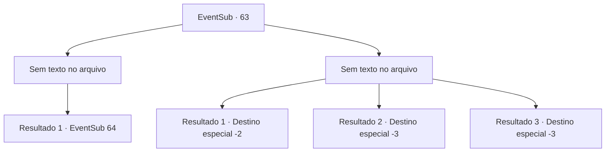

# Eventos secundários · 63

[Índice da tabela](index.md) · [Índice geral](../index.md)

ID: `pt:EventSub:63` · Fonte: `EventSub4` · Versão: 1.2.47.

Mapeamento estático dos arquivos; a disponibilidade e a execução dependem do estado da run.

## Texto do evento

*Sem texto no arquivo.*

## Dados de entrada

```json
{
  "id": 63,
  "grade": 1,
  "subEvent": "2",
  "required": ""
}
```

## Mapa das escolhas



## Escolhas e resultados

### Escolha 1

*Sem texto no arquivo; o papel dessa opção depende da interface do jogo.*

Requisitos e outros campos da escolha:

```json
{
  "required": ""
}
```

#### Resultado 1.1

Você derruba com sucesso os guardas. Mas mais pressa e cercam você. Uma mulher de meia idade vestida de seda vermelha se aproxima de você. |drawing_sesil| Ela deve ser Cecil Leo. Ela olha para você nos olhos enquanto fala. 

 "Você está lá, vejo que você é muito bom no que faz. Vou te dar 500 ouro se você mudar de lado."


Continuação registrada: [Evento 64](0064.md) na mesma tabela.

```json
{
  "required": "",
  "chance": "1",
  "nextEvent": 64,
  "type": 2,
  "reward": ""
}
```

### Escolha 2

*Sem texto no arquivo; o papel dessa opção depende da interface do jogo.*

Requisitos e outros campos da escolha:

```json
{
  "required": ""
}
```

#### Resultado 2.1

Você não é páreo para os guardas. Enard também não é. A diferença é que você tem sorte o suficiente para escapar, e Enard não.

Continuação registrada: [Destino especial `-2`](../destinos-especiais.md).

```json
{
  "required": "1_0_2|1_1_2",
  "chance": "1",
  "nextEvent": -2,
  "type": 2,
  "reward": "0_0_-1|0_1_-1|12_2_-1|0_2_1|14_2_8"
}
```

#### Resultado 2.2

Você não é páreo para os guardas. Suas lâminas reivindicam sua vida.

Continuação registrada: [Destino especial `-3`](../destinos-especiais.md).

```json
{
  "required": "2_0_2",
  "chance": "1",
  "nextEvent": -3,
  "type": 2,
  "reward": "0_0_-1|0_1_-1"
}
```

#### Resultado 2.3

Você não é páreo para os guardas. Suas lâminas reivindicam sua vida.

Continuação registrada: [Destino especial `-3`](../destinos-especiais.md).

```json
{
  "required": "2_1_2",
  "chance": "1",
  "nextEvent": -3,
  "type": 2,
  "reward": "0_0_-1|0_1_-1"
}
```

## Referências que chegam a este evento

- [Evento 62 · escolha 2 · resultado 1](0062.md#escolha-2)
- [Evento 62 · escolha 2 · resultado 2](0062.md#escolha-2)
- [Evento 62 · escolha 3 · resultado 2](0062.md#escolha-3)
