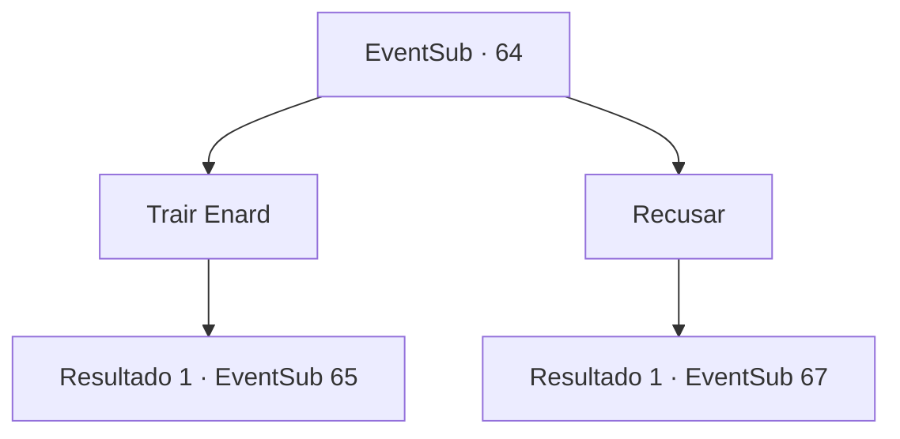

# Eventos secundários · 64

[Índice da tabela](index.md) · [Índice geral](../index.md)

ID: `pt:EventSub:64` · Fonte: `EventSub4` · Versão: 1.2.47.

Mapeamento estático dos arquivos; a disponibilidade e a execução dependem do estado da run.

## Texto do evento

*Sem texto no arquivo.*

## Dados de entrada

```json
{
  "id": 64,
  "grade": 1,
  "subEvent": "2",
  "required": ""
}
```

## Mapa das escolhas



## Escolhas e resultados

### Escolha 1

Trair Enard

Requisitos e outros campos da escolha:

```json
{
  "required": ""
}
```

#### Resultado 1.1

Você aceita a oferta de Cecil. Enard olha para você, indignado, enquanto Cecil sorri satisfeito. 

 "Mate-o. Mate-o e ganhe minha confiança."

 Num instante, Enard tira sua adaga e a balança em sua direção.

Continuação registrada: [Evento 65](0065.md) na mesma tabela.

```json
{
  "required": "",
  "chance": "1",
  "nextEvent": 65,
  "type": 2,
  "reward": "6_0_65|0_3_-1",
  "place": 1
}
```

### Escolha 2

Recusar

Requisitos e outros campos da escolha:

```json
{
  "required": ""
}
```

#### Resultado 2.1

Você recusa a oferta de Cecil. Você e Enard enfrentam os guardas com as costas um contra o outro.

Continuação registrada: [Evento 67](0067.md) na mesma tabela.

```json
{
  "required": "",
  "chance": "1",
  "nextEvent": 67,
  "type": 2,
  "reward": "6_0_91|0_3_1",
  "place": 1
}
```

## Referências que chegam a este evento

- [Evento 63 · escolha 1 · resultado 1](0063.md#escolha-1)
