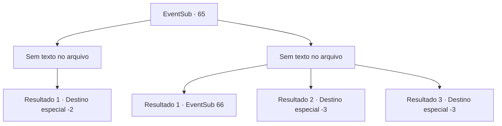

# Eventos secundários · 65

[Índice da tabela](index.md) · [Índice geral](../index.md)

ID: `pt:EventSub:65` · Fonte: `EventSub4` · Versão: 1.2.47.

Mapeamento estático dos arquivos; a disponibilidade e a execução dependem do estado da run.

## Texto do evento

*Sem texto no arquivo.*

## Dados de entrada

```json
{
  "id": 65,
  "grade": 1,
  "subEvent": "2",
  "required": ""
}
```

## Mapa das escolhas



## Escolhas e resultados

### Escolha 1

*Sem texto no arquivo; o papel dessa opção depende da interface do jogo.*

Requisitos e outros campos da escolha:

```json
{
  "required": ""
}
```

#### Resultado 1.1

Enard dá uma luta decente, mas no final não é páreo para você. Ele dá seu último suspiro sob seus pés. Cecil aplaude enquanto te elogia. 

 "Ótima luta. Vamos, honre esse guerreiro com nosso ouro."

 Ela faz um gesto com os dedos. Dois guardas te entregam um baú volumoso. Ele está cheio de ouro. Cecil volta para sua carruagem com elegância e parte.

Continuação registrada: [Destino especial `-2`](../destinos-especiais.md).

```json
{
  "required": "",
  "chance": "1",
  "nextEvent": -2,
  "type": 2,
  "reward": "0_3_-5|0_4_500|12_2_-1|0_2_3|14_2_6"
}
```

### Escolha 2

*Sem texto no arquivo; o papel dessa opção depende da interface do jogo.*

Requisitos e outros campos da escolha:

```json
{
  "required": ""
}
```

#### Resultado 2.1

Você falha em acabar com Enard. Ele joga uma bomba de fumaça. Uma nuvem espessa sobe do chão, ganhando tempo para ele escapar. Cecil aplaude sarcasticamente. 

 "Eu acho que você não é tão bom quanto eu pensava."

 Ela faz um gesto com os dedos. Os guardas avançam todos de uma vez.

Continuação registrada: [Evento 66](0066.md) na mesma tabela.

```json
{
  "required": "1_0_2|1_1_2",
  "chance": "1",
  "nextEvent": 66,
  "type": 2,
  "reward": "6_3_91|0_3_-2|0_2_1",
  "place": 1
}
```

#### Resultado 2.2

Você falha em derrotar Enard. Muito pelo contrário, na verdade. A adaga de Enard corta sua garganta e você desaba no local.

Continuação registrada: [Destino especial `-3`](../destinos-especiais.md).

```json
{
  "required": "2_0_2",
  "chance": "1",
  "nextEvent": -3,
  "type": 2,
  "reward": "0_0_-1|0_1_-1"
}
```

#### Resultado 2.3

Você falha em derrotar Enard. Muito pelo contrário, na verdade. A adaga de Enard corta sua garganta e você desaba no local.

Continuação registrada: [Destino especial `-3`](../destinos-especiais.md).

```json
{
  "required": "2_1_2",
  "chance": "1",
  "nextEvent": -3,
  "type": 2,
  "reward": "0_0_-1|0_1_-1"
}
```

## Referências que chegam a este evento

- [Evento 64 · escolha 1 · resultado 1](0064.md#escolha-1)
