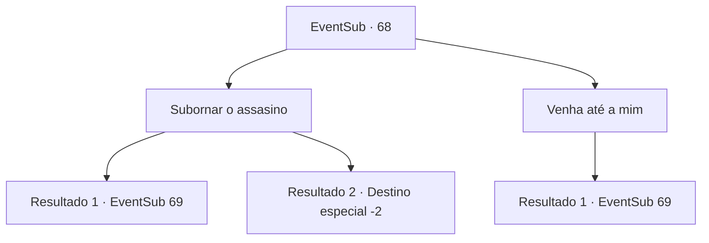

# Eventos secundários · 68

[Índice da tabela](index.md) · [Índice geral](../index.md)

ID: `pt:EventSub:68` · Fonte: `EventSub4` · Versão: 1.2.47.

Mapeamento estático dos arquivos; a disponibilidade e a execução dependem do estado da run.

## Texto do evento

É uma noite sem lua e você não consegue dormir. Você está rolando e virando em sua barraca quando ouve algo do lado de fora. Você se levanta e vê alguém nas sombras.

## Dados de entrada

```json
{
  "id": 68,
  "grade": 1,
  "subEvent": "2",
  "required": "12_2_8"
}
```

## Mapa das escolhas



## Escolhas e resultados

### Escolha 1

Subornar o assasino

Requisitos e outros campos da escolha:

```json
{
  "required": "1_4_400"
}
```

#### Resultado 1.1

Você tenta subornar o assassino. Mas ele não ouve. Parece que ele não vai negociar. A adaga do assassino brilha no escuro.

Continuação registrada: [Evento 69](0069.md) na mesma tabela.

```json
{
  "required": "",
  "chance": "15",
  "nextEvent": 69,
  "type": 1,
  "reward": "6_3_48",
  "place": 1
}
```

#### Resultado 1.2

Você sobrecarrega o assassino com seu carisma ardente. Então você o suborna com sucesso com seu ouro. Ele lhe entrega um pergaminho depois de guardar o dinheiro. Ele detalha a programação do assassino para encontrar o cliente em uma igreja em Alengrad depois de te matar. Você decide surpreender o cliente.

Continuação registrada: [Destino especial `-2`](../destinos-especiais.md).

```json
{
  "required": "",
  "chance": "1|0_12_1",
  "nextEvent": -2,
  "type": 0,
  "reward": "0_4_-400|0_2_2|12_2_10"
}
```

### Escolha 2

Venha até a mim

Requisitos e outros campos da escolha:

```json
{
  "required": ""
}
```

#### Resultado 2.1

A adaga do assassino brilha no escuro.

Continuação registrada: [Evento 69](0069.md) na mesma tabela.

```json
{
  "required": "",
  "chance": "1",
  "nextEvent": 69,
  "type": 2,
  "reward": "6_0_48",
  "place": 1
}
```

## Referências que chegam a este evento

Nenhum `nextEvent` positivo da mesma tabela aponta para este nó. Isso não prova que seja inacessível: sorteio e estado de história podem selecioná-lo.

