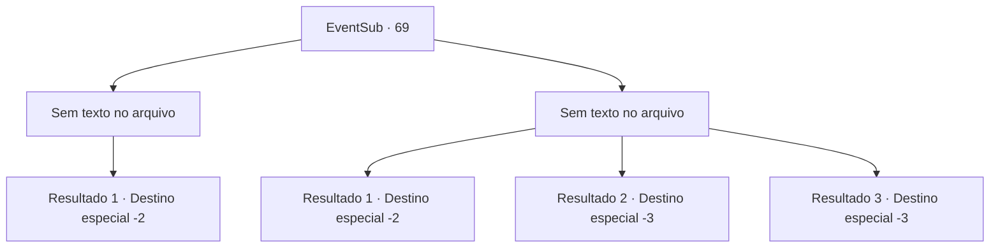

# Eventos secundários · 69

[Índice da tabela](index.md) · [Índice geral](../index.md)

ID: `pt:EventSub:69` · Fonte: `EventSub4` · Versão: 1.2.47.

Mapeamento estático dos arquivos; a disponibilidade e a execução dependem do estado da run.

## Texto do evento

*Sem texto no arquivo.*

## Dados de entrada

```json
{
  "id": 69,
  "grade": 1,
  "subEvent": "2",
  "required": ""
}
```

## Mapa das escolhas



## Escolhas e resultados

### Escolha 1

*Sem texto no arquivo; o papel dessa opção depende da interface do jogo.*

Requisitos e outros campos da escolha:

```json
{
  "required": ""
}
```

#### Resultado 1.1

Você derrota o assassino e encontra um pequeno pergaminho em seu bolso. Ele detalha a programação do assassino para encontrar o cliente em uma igreja em Alengrad depois de te matar. Você decide surpreender o cliente.

Continuação registrada: [Destino especial `-2`](../destinos-especiais.md).

```json
{
  "required": "",
  "chance": "1",
  "nextEvent": -2,
  "type": 2,
  "reward": "12_2_10"
}
```

### Escolha 2

*Sem texto no arquivo; o papel dessa opção depende da interface do jogo.*

Requisitos e outros campos da escolha:

```json
{
  "required": ""
}
```

#### Resultado 2.1

Os dois de vocês brigam a noite toda. Já é amanhecer quando o assassino foge. Você segura sua ferida e desmaia. Ele voltará em breve.

Continuação registrada: [Destino especial `-2`](../destinos-especiais.md).

```json
{
  "required": "1_0_2|1_1_2",
  "chance": "1",
  "nextEvent": -2,
  "type": 2,
  "reward": "12_2_8|0_0_-1|0_1_-1|0_2_1"
}
```

#### Resultado 2.2

Tentas lutar contra o assassino, mas não és páreo para ele. A sua adaga de forma bizarra corta a tua garganta.

Continuação registrada: [Destino especial `-3`](../destinos-especiais.md).

```json
{
  "required": "2_0_2",
  "chance": "1",
  "nextEvent": -3,
  "type": 2,
  "reward": "0_0_-1|0_1_-1"
}
```

#### Resultado 2.3

Tentas lutar contra o assassino, mas não és páreo para ele. A sua adaga de forma bizarra corta a tua garganta.

Continuação registrada: [Destino especial `-3`](../destinos-especiais.md).

```json
{
  "required": "2_1_2",
  "chance": "1",
  "nextEvent": -3,
  "type": 2,
  "reward": "0_0_-1|0_1_-1"
}
```

## Referências que chegam a este evento

- [Evento 68 · escolha 1 · resultado 1](0068.md#escolha-1)
- [Evento 68 · escolha 2 · resultado 1](0068.md#escolha-2)
